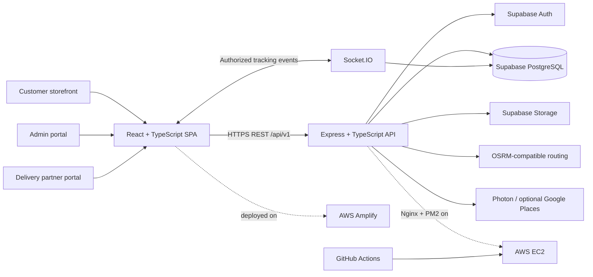

# Hindustan Hardware & Sanitary

A full-stack e-commerce and delivery operations platform for a hardware and sanitaryware retailer. The application brings the customer storefront, store administration, and delivery-partner workflow together around one API and a shared PostgreSQL data model.

## What the application does

Customers can browse and compare products, manage a cart and wishlist, save delivery addresses, place orders, and follow payment and delivery progress. Store staff manage the catalogue, stock, orders, customers, delivery assignments, and payment collection. Delivery partners use a dedicated portal to work assigned orders, share GPS location, navigate to the customer, and verify handoff with an order OTP.

The core feature is the connected order lifecycle: catalogue and inventory feed checkout; checkout records an authoritative order and price snapshot; staff assign delivery; the partner reports location and confirms handoff; customer and staff views receive tracking and status updates.

## Stack

| Area | Technologies |
| --- | --- |
| Web application | React 19, TypeScript, Vite, React Router 7, Tailwind CSS 4 |
| Maps and live updates | Leaflet, browser geolocation, Socket.IO client |
| API | Node.js 22, Express 4, TypeScript, REST API under `/api/v1` |
| Data and identity | Supabase Auth, Supabase PostgreSQL, SQL migrations, Supabase Storage |
| API validation and security | Zod, Helmet, CORS allowlist, rate limiting, role-based authorization |
| Images and catalogue tools | Multer, Sharp, XLSX catalogue import/export utilities |
| Backend tests | Vitest, Supertest |
| Frontend tests | Playwright end-to-end test setup |
| Hosting and delivery | AWS Amplify frontend, AWS EC2 backend, Nginx, PM2, GitHub Actions self-hosted runner |

## Product capabilities

### Customer storefront

- Browse, search, filter, and view products, categories, brands, stock, images, and discounts.
- Compare products and view alternatives where catalogue comparison data is available.
- Use a guest cart or a signed-in persistent cart; merge guest cart items after authentication.
- Save addresses and products to a wishlist.
- Check delivery coverage and applicable fees during checkout.
- Place orders and view order history, item and price snapshots, payment status, collected amount, outstanding balance, and collection history.
- View the delivery OTP on the order page and follow delivery status, map location, route, and best-effort ETA.
- Share a limited-access tracking link where enabled.

### Admin and staff operations

- Manage products, images, categories, brands, inventory, and customers.
- Review and manage orders, cancel eligible orders, and assign delivery partners.
- Create phone orders and record full or partial cash-on-delivery collections.
- Review inventory movements and audit records.
- Configure the store-wide payment QR image displayed in the delivery workflow.
- Configure delivery coverage and fees through the operational settings supported by the backend.

### Delivery partner portal

- View assigned orders and update the delivery workflow.
- Share validated GPS updates while on delivery; current and historical locations are stored.
- See customer destination, road route, and estimated arrival information when routing data is available.
- Verify the customer handoff with the order's six-digit OTP. The backend rejects incorrect, expired, or locked OTP verification; only successful verification completes delivery.
- View the store payment QR when collecting payment.

## Engineering highlights

- **Server-owned checkout:** the backend validates cart, availability, delivery, and prices. It persists order totals and line-item price snapshots so later catalogue edits do not silently alter an existing order.
- **Transactional order operations:** order creation, inventory effects, cancellation, delivery verification, and payment collection are coordinated through backend services and database functions/constraints where required.
- **Authorization at the API boundary:** Supabase access tokens are verified on protected requests. Admin, staff, customer, and delivery-partner capabilities are separated by server-side role and resource-ownership checks; UI route guards are not treated as security controls.
- **Safer delivery OTPs:** OTPs are generated on the backend, stored as a keyed digest for verification, and encrypted for retrieval by the owning customer. Verification is atomic, attempt-limited, and restricted to the assigned delivery workflow.
- **Scoped live tracking:** Socket.IO delivery rooms authorize the customer, assigned partner, or permitted staff before subscription. Location and status events are broadcast after the backend accepts and persists the update.
- **Validated and observable API:** Zod schemas validate inputs; shared middleware handles request IDs, structured logging, rate limiting, response formatting, and centralized error handling. Health and dependency-readiness endpoints support operations.
- **Database evolution:** ordered SQL files in `backend/migrations/` describe schema and database-function changes. They are applied explicitly to Supabase and are not automatically run by application startup or the deploy workflow.
- **Practical release flow:** GitHub Actions builds the backend on a hosted runner, packages the artifact, then deploys it to the EC2 self-hosted runner. The deploy script installs production dependencies, restarts PM2, and checks API readiness. Amplify builds and publishes the frontend.

## Architecture



The frontend is a role-aware single-page app. It calls the versioned Express API for business operations. Supabase provides identity, PostgreSQL, and object storage. Socket.IO complements REST for live delivery tracking; persisted API state remains available after reconnecting.

## Repository layout

```text
.
├── frontend/
│   ├── src/app/user/       # Storefront, checkout, orders, tracking
│   ├── src/app/admin/      # Store administration
│   ├── src/app/partner/    # Delivery partner portal
│   ├── src/app/features/   # API clients, hooks, maps, tracking components
│   └── public/             # Static assets, PWA manifest and service worker
├── backend/
│   ├── src/routes/         # HTTP route groups
│   ├── src/services/       # Checkout, order, catalogue, payment and delivery logic
│   ├── src/common/         # Middleware, validation, errors and Socket.IO
│   ├── migrations/         # Ordered PostgreSQL migrations
│   └── tests/              # Vitest API and service tests
├── .github/workflows/      # Backend build and EC2 deployment workflow
└── amplify.yml             # AWS Amplify frontend build configuration
```

## Local development

Requirements: Node.js 22 and npm. The frontend and backend run as separate processes.

### Backend

Create `backend/.env` with local Supabase credentials and the settings required by `backend/src/config/env.ts`. Do not commit real credentials.

```bash
cd backend
npm ci
npm run dev
```

The API listens on port `5000` by default. The source includes readiness checks at `/api/v1/health/ready`.

### Frontend

Create `frontend/.env.local` with the local API and Socket.IO URLs:

```dotenv
VITE_API_BASE_URL=http://localhost:5000/api/v1
VITE_SOCKET_URL=http://localhost:5000
VITE_PUBLIC_APP_URL=http://localhost:5173
```

```bash
cd frontend
npm ci
npm run dev
```

Only public browser configuration belongs in `VITE_*` variables. Supabase service-role credentials, OTP encryption keys, and other secrets must stay on the backend.

## Useful commands

```bash
# Backend, from backend/
npm run build
npm run typecheck
npm test

# Frontend, from frontend/
npm run build
npm run test:e2e
```

Tests that use a database or external services should use a dedicated test project/account. Do not point destructive or seed workflows at production data.

## Deployment overview

- **Frontend:** `amplify.yml` builds the Vite app from `frontend/` and publishes `frontend/dist`. The deployed frontend needs `VITE_API_BASE_URL` and `VITE_SOCKET_URL` configured for its API origin.
- **Backend:** `.github/workflows/deploy-backend.yml` builds on pushes to `main` affecting backend files (or by manual dispatch), then uses the Linux x64 EC2 self-hosted runner to deploy the artifact. PM2 keeps the Node process running; Nginx terminates HTTPS and proxies requests to the API.
- **Database:** apply new SQL migrations to the intended Supabase project as a deliberate release step. The GitHub workflow does not run database migrations.
- **Secrets:** production environment values live on the backend host or in the relevant hosting configuration. Never put server-only secrets in GitHub source files or frontend build variables.

## Payment scope

The current order flow supports cash-on-delivery collection, including partial collection and balance tracking. The QR feature displays the store's configured payment reference image to assist collection. The repository does not implement a payment-gateway checkout or automatically reconcile transactions from a payment provider.

## Interview walkthrough

1. Start with the three roles and explain the order lifecycle they share.
2. Demonstrate product discovery, comparison, cart, checkout, and the customer's order/OTP page.
3. Show the admin catalogue/inventory and order assignment workflow.
4. Open the delivery-partner portal and demonstrate live location/status updates and OTP-based delivery completion.
5. Explain the security and consistency choices: server-side pricing, role and ownership checks, immutable order snapshots, atomic OTP verification, and database migrations.
6. Finish with the deployment pipeline: Amplify for the SPA and GitHub Actions to EC2/PM2 for the API.

### Short project summary

> I built a full-stack commerce and delivery operations application for a hardware retailer. The customer storefront, admin tools, and delivery-partner portal share a TypeScript API and a PostgreSQL data model. I focused on reliable checkout and price snapshots, role-based access, inventory-aware order operations, OTP-verified handoff, and real-time delivery tracking, then deployed the frontend and backend through AWS hosting and GitHub Actions.
