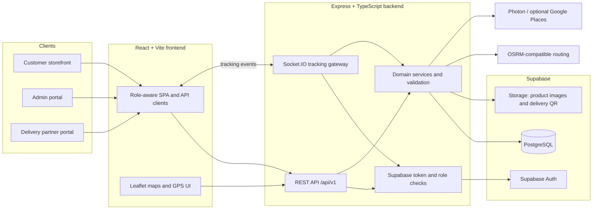

# Hindustan Hardware

End-to-end architecture and operating guide for the Hindustan Hardware & Sanitary storefront. Application source code is in [`Hindustan-Hardware/`](./Hindustan-Hardware/); the frontend and backend have their own detailed guides:

- [Frontend README](./Hindustan-Hardware/frontend/Readme.md)
- [Backend README](./Hindustan-Hardware/backend/README.md)
- [Frontend deployment guide](./Hindustan-Hardware/frontend/AMPLIFY_DEPLOYMENT.md)
- [Frontend browser testing guide](./Hindustan-Hardware/frontend/TESTING.md)
- [Backend verification guide](./Hindustan-Hardware/backend/TESTING.md)

## Product overview

The application supports a hardware and sanitary products storefront, authenticated customer accounts, order placement, admin operations, and a delivery-partner portal with live order tracking. Customers can browse products, manage a cart, place cash-on-delivery orders, and follow order/payment progress. Administrators manage the catalogue, inventory, orders, delivery assignment, payment collection, and the store-wide delivery payment QR. Delivery partners view assigned orders, report GPS location, navigate to the customer, and display the QR when collecting payment.

The frontend is a browser-based single-page application. The backend is a versioned REST API and Socket.IO server. Supabase provides authentication, PostgreSQL, and object storage. Road routing and address search use external providers where configured.

## Architecture



### Main components

| Component | Responsibility |
| --- | --- |
| `frontend/` | React 19, TypeScript, Vite, Tailwind CSS, React Router, Leaflet, and Socket.IO client. Owns customer, admin, and delivery-partner user experiences. |
| `backend/` | Node.js/Express API, request validation, business services, admin and role authorization, file uploads, and Socket.IO tracking. |
| Supabase Auth | User sign-in and JWTs. The backend verifies tokens and loads the user's role before accessing protected features. |
| Supabase PostgreSQL | Authoritative catalogue, inventory, profiles, carts, orders, payments, delivery assignments, GPS history, settings, and audit data. |
| Supabase Storage | Product and other public images, including the current delivery payment QR image. |
| Socket.IO | Authorized real-time delivery location and status updates in per-delivery rooms. |
| OSRM-compatible router | Best-effort road-following geometry and ETA input for live delivery views. |
| Photon / optional Google Places | Address search and place resolution. Google Places API credentials remain on the backend. |

### Source layout

```text
Hindustan-Hardware/
├── frontend/
│   ├── src/app/
│   │   ├── user/          # Storefront, account, checkout, order details and tracking
│   │   ├── admin/         # Admin dashboard and operations
│   │   ├── partner/       # Delivery partner orders, map and payment QR
│   │   ├── components/    # Shared UI, GPS, and map components
│   │   ├── api/           # Shared HTTP client
│   │   ├── features/      # API clients, hooks, and feature components
│   │   └── App.tsx        # Application routes
│   ├── public/
│   ├── Readme.md
│   └── AMPLIFY_DEPLOYMENT.md
├── backend/
│   ├── src/
│   │   ├── routes/        # Versioned HTTP route groups
│   │   ├── services/      # Checkout, orders, admin, delivery, QR, and other domain logic
│   │   ├── common/        # Middleware, response helpers, logging, and Socket.IO
│   │   └── config/        # Environment and Supabase clients
│   ├── migrations/        # Ordered PostgreSQL migrations
│   ├── tests/
│   └── README.md
├── amplify.yml            # Frontend Amplify build/publish configuration
└── .github/workflows/     # Backend build and deployment workflow
```

## End-to-end workflows

### Customer: browse, buy, and track

1. A visitor opens the storefront, browses products, and views available price and stock information from the API.
2. The visitor signs in or creates a customer account. After sign-in, the customer is routed to the storefront home page; account and order history remain accessible from navigation.
3. The customer adds products to the cart and submits shipping details. Checkout validates availability and the effective displayed item prices on the server.
4. The backend creates the order and line-item snapshots atomically. The stored order amounts are authoritative; later catalogue discounts or price edits do not recalculate a placed order.
5. The customer views the order status page, including order totals, payment status, amount collected, balance due, and collection history. When delivery tracking is active, GPS, route, and best-effort ETA are refreshed from the API and authorized Socket.IO events.
6. Cancellation is available only when allowed by the order lifecycle. The backend owns the eligibility check and any associated inventory restoration.

### Admin: operate the store and orders

1. An administrator signs in and opens the overview dashboard for store metrics, orders, and operational notifications.
2. Admin tools manage products, categories, brands, inventory, customers, and audit records through authenticated admin APIs.
3. The admin reviews an order's immutable item-price snapshots and payable total, updates its permitted operational state, cancels eligible orders, or assigns an available delivery partner.
4. For a COD order, the admin records all or part of the collected amount. The backend persists the collection event and updates the payment status to `pending`, `partially_paid`, or `paid` based on the total payable amount, including the delivery fee.
5. The admin can upload or replace the store-wide delivery payment QR from the overview. The setting is persisted in the database, and the image is stored in Supabase Storage.
6. Admin order views preserve fractional amounts (for example `₹107.75`) rather than rounding them for display. The delivery workflow is separate from the removed redundant “Update Order Milestone” panel.

### Delivery partner: assigned order through delivery

1. The authenticated partner opens the partner portal and sees assignments associated with their account.
2. The partner selects an order, reviews delivery details, and starts the active delivery workflow.
3. With browser location permission, the portal submits validated GPS updates. The backend verifies assignment ownership and status, persists accepted locations, and broadcasts committed updates to authorized clients.
4. The map shows the partner, destination, and road route. Full-screen navigation rotates to follow the current heading when available and uses movement direction as a fallback. The destination marker remains available when the partner marks arrival.
5. The partner can open the payment QR from the selected order. The QR is read-only in this portal and comes from the admin's current store-wide upload.
6. Delivery status changes are validated by the backend. Customer and admin tracking views receive status/location events and can also retrieve persisted state after reconnecting.

## Order, payment, and delivery model

### Pricing and payment

- The backend, not the browser, is authoritative for order creation and payment state.
- Checkout persists order and item price snapshots. The order's original total is not recomputed from current catalogue prices after placement.
- Payable amount includes the delivery fee when applicable.
- Every accepted COD collection is recorded as a separate history entry. Partial payments leave an outstanding balance; full collection marks the payment `paid`.
- Customer, admin, and delivery views should use persisted order/payment data rather than independently recalculating a discount.

### Delivery lifecycle and live tracking

- A delivery assignment connects an order, customer, and delivery partner.
- Partner GPS is validated, timestamped, persisted as current location and history, and broadcast only after the backend has accepted the update.
- Socket.IO rooms are delivery-specific. The backend authorizes room subscriptions for the customer who owns the order, assigned partner, or an authorized administrator.
- Routing and ETA are best-effort estimates, not a delivery guarantee. Stale GPS may cause ETA to be unavailable.
- The full set of status transitions and field-level API contracts are documented in the backend README and route/service implementation.

## API surface

All application REST endpoints are versioned under `/api/v1`. The backend exposes route groups for:

| Route group | Typical use |
| --- | --- |
| `/health` and `/health-check` | Process/dependency health checks. |
| `/auth` | Authentication-related operations and profile role resolution. |
| `/products`, `/categories`, `/brands` | Public catalogue browsing. |
| `/cart`, `/checkout` | Guest/customer cart and order creation. |
| `/customers/me` | Customer profile, addresses, wishlist, order history, payment details, cancellation, and tracking. |
| `/admin` | Admin catalogue, inventory, dashboard, customers, order/payment operations, delivery assignment, and QR management. |
| `/deliveries` | Partner assignments, status, location ingestion/retrieval, route, ETA, and partner QR retrieval. |
| `/public/tracking` | Limited-access, expiring shared tracking links. |

The API uses bearer JWTs for protected operations. Admin routes require the admin role; delivery routes also enforce assignment ownership. Error responses include request metadata for log correlation. See [backend README](./Hindustan-Hardware/backend/README.md) for detailed endpoints and payloads.

## Database and migration deployment

Database changes live in `Hindustan-Hardware/backend/migrations/` and are applied explicitly to Supabase; starting the Node server does not run migrations. Apply unapplied migration files in numeric order to the Supabase project configured in the backend. Confirm the project before running SQL and do not rerun non-idempotent data migrations blindly.

Recent migrations that affect current checkout/payment/QR behavior:

| Migration | Change |
| --- | --- |
| `016_partial_order_payment_collection.sql` | Payment collection records and initial collection RPC. |
| `017_phone_orders_and_tracking_shares.sql` | Admin phone orders and revocable/expiring public tracking links. |
| `018_delivery_coverage_and_fee.sql` | Delivery area/fee configuration and order delivery-fee support. |
| `019_include_delivery_fee_in_payable_amount.sql` | Include delivery fee in the amount due and collection logic. |
| `020_checkout_preserve_displayed_prices.sql` | Preserve the customer-visible effective price as the order snapshot. |
| `021_fix_payment_collection_amount_constraint.sql` | Remove the stale collected-amount upper-bound constraint. |
| `022_show_partial_payment_status.sql` | Add and reconcile `partially_paid` status and related RPC/trigger logic. |
| `023_delivery_payment_qr_setting.sql` | Add the database setting used by admin upload and partner QR display. |

**QR deployment prerequisite:** apply migration `023` to the same Supabase project used by the backend. The existing public `product-images` storage bucket must be available. The backend must have `SUPABASE_SERVICE_ROLE_KEY` configured; this key must never be exposed to the frontend.

## Local development

Use Node.js 22 (or the version specified by the deployment pipeline) and npm. Configure the backend and frontend in separate terminals. Do not copy production credentials into local files or commit `.env` files.

### Backend

Create `Hindustan-Hardware/backend/.env` with the necessary local/staging settings. The actual validated configuration is in `backend/src/config/env.ts`.

```dotenv
NODE_ENV=development
PORT=5000
HOST=0.0.0.0
CORS_ORIGIN=http://localhost:5173
SUPABASE_URL=https://YOUR_PROJECT.supabase.co
SUPABASE_ANON_KEY=YOUR_PUBLIC_ANON_KEY
SUPABASE_SERVICE_ROLE_KEY=YOUR_SERVER_ONLY_SERVICE_ROLE_KEY
```

Additional optional settings include `GOOGLE_MAPS_API_KEY`, `DELIVERY_OTP_ENCRYPTION_KEY`, tracking freshness/accuracy controls, `OSRM_ROUTER_URL`, and route-cache thresholds. Never publish or commit real key values.

```bash
cd Hindustan-Hardware/backend
npm ci
npm run dev
```

The API defaults to `http://localhost:5000`; health routes are available for readiness/liveness checks.

### Frontend

Set the frontend build-time variables in `Hindustan-Hardware/frontend/.env.local` for local development:

```dotenv
VITE_API_BASE_URL=http://localhost:5000/api/v1
VITE_SOCKET_URL=http://localhost:5000
VITE_PUBLIC_APP_URL=http://localhost:5173
```

```bash
cd Hindustan-Hardware/frontend
npm ci
npm run dev
```

Vite variables are embedded in the browser bundle. Only public URLs and public client configuration belong in `VITE_*`; service-role keys, private API keys, and database credentials must remain backend-only.

## Verification

Run checks from the relevant project directory:

```bash
# backend
npm run typecheck
npm test
npm run build
```

```bash
# frontend
npm run build
npm run test:e2e
```

The frontend Playwright test may require a browser installation (`npx playwright install chromium`). The backend production smoke checks need a running backend and configured Supabase project. Read each app's `TESTING.md` before running checks against shared or production systems; the optional database integration test must use a disposable database.

## Deployment

### Frontend

The checked-in `Hindustan-Hardware/amplify.yml` deploys the Vite frontend to AWS Amplify, builds from the `frontend/` app root, and publishes `dist/`. Configure `VITE_API_BASE_URL`, `VITE_SOCKET_URL`, and optionally `VITE_PUBLIC_APP_URL` in the Amplify environment. Add the SPA rewrite from `/<*>` to `/index.html` so deep links and refreshes resolve. The backend is deployed separately.

### Backend

The GitHub Actions workflow builds the backend on Node.js 22 for changes under `backend/` on the configured main branch, then deploys the artifact using a self-hosted Linux runner and the checked-in deployment script. The server runs under PM2 behind the configured HTTPS/reverse-proxy endpoint and is checked through its readiness URL.

Database migrations are a separate operation and are not run by either frontend or backend deployment. Deploy compatible backend/frontend code and apply the needed SQL migration to the correct Supabase project before enabling a feature that depends on it. An already-installed web app receives frontend updates from the deployed site; it does not need to be reinstalled, though it may need to be reopened or refreshed to load the new version.

## Security and operational notes

- Keep all `.env` files, service-role keys, encryption keys, and test account passwords out of source control and browser bundles.
- Use a narrow `CORS_ORIGIN` allowlist for deployed environments.
- Apply role and ownership checks on the server; frontend route guards are not an authorization boundary.
- Use request IDs from error responses to locate backend logs.
- Use dedicated staging accounts and a staging database for tests that exercise authenticated workflows.
- The uploaded QR is a store-wide payment reference image, not a payment provider integration or proof of payment. Payment collection still needs to be recorded through the authorized application workflow.
- Maps, third-party address search, road routing, browser geolocation, and live ETA depend on provider availability and user/device permissions.

## Recent completed product changes

- Customer login routes back to the storefront home; existing order totals retain checkout price snapshots.
- Payment status, amount collected, amount due, and collection history appear in customer order details.
- Admin order totals retain decimal precision; partial COD collection is reflected in the payment status.
- Admin order detail no longer duplicates delivery milestone controls; the obsolete Delivery Orders sidebar link was removed.
- Admin notification layout is responsive.
- Admin overview supports uploading the delivery payment QR; delivery partners can open it from an assigned order.
- Delivery partner full-screen navigation follows direction, refreshes the route while moving, and presents the destination marker for the arrival workflow.
- Backend migrations `020`–`023` cover checkout snapshot prices, payment collection constraint/status fixes, and persistent delivery QR settings.