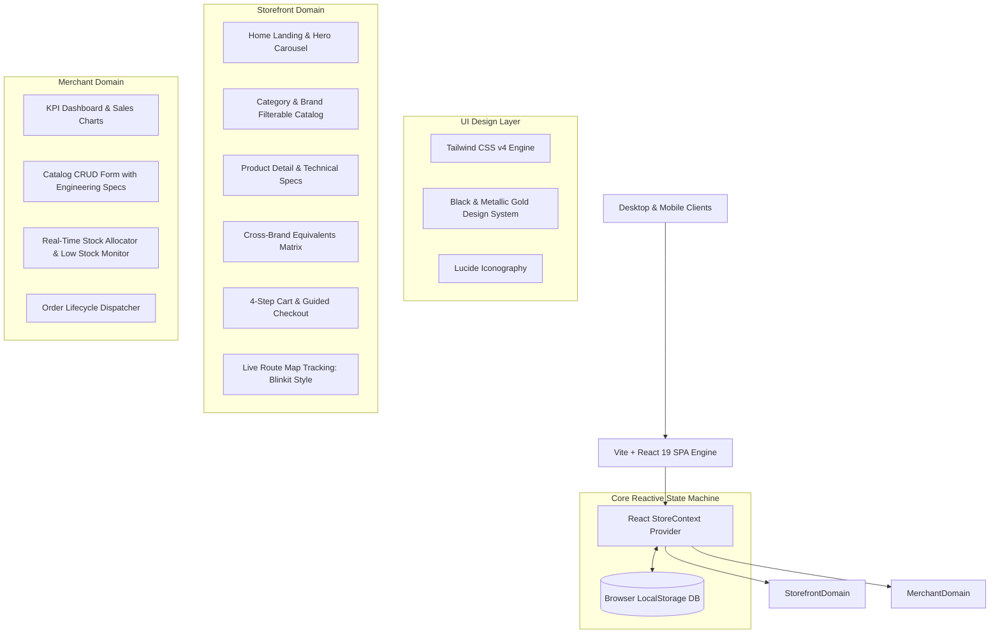
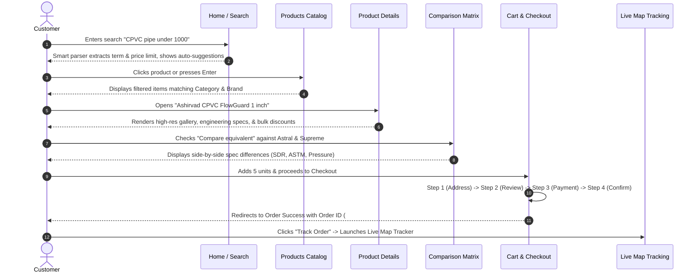

# Hindustan Hardware & Sanitary — Complete Technical & End-to-End Workflow Documentation

> **Production-Grade Architecture Specification, User Experience Guide & Admin Operations Manual**  
> *Crafted for Hindustan Hardware & Sanitary — Established 1993, Jehanabad, Bihar*

---

## 📑 Comprehensive Table of Contents

1. [Executive Overview & System Architecture](#1-executive-overview--system-architecture)
2. [Visual Design System & Brand Identity](#2-visual-design-system--brand-identity)
3. [Repository Directory & File Breakdown](#3-repository-directory--file-breakdown)
4. [Customer / User-Side End-to-End Workflows](#4-customer--user-side-end-to-end-workflows)
   - [4.1 Discovery, Hero Banners & Application Showcases](#41-discovery-hero-banners--application-showcases)
   - [4.2 Smart Search Engine (Keywords, Autocomplete & Budget Parsing)](#42-smart-search-engine-keywords-autocomplete--budget-parsing)
   - [4.3 Dynamic Catalog Browsing & Multi-Faceted Filtering](#43-dynamic-catalog-browsing--multi-faceted-filtering)
   - [4.4 Category-Wise & Brand-Wise Product Sorting](#44-category-wise--brand-wise-product-sorting)
   - [4.5 Product Detail Page (PDP): Gallery, Technical Specs & Bulk Tier Pricing](#45-product-detail-page-pdp-gallery-technical-specs--bulk-tier-pricing)
   - [4.6 Equivalent Product Cross-Brand Comparison Matrix](#46-equivalent-product-cross-brand-comparison-matrix)
   - [4.7 Wishlist & Reordering Engine](#47-wishlist--reordering-engine)
   - [4.8 Cart Management & Free Delivery Qualification Meter](#48-cart-management--free-delivery-qualification-meter)
   - [4.9 4-Step Guided Checkout Wizard](#49-4-step-guided-checkout-wizard)
   - [4.10 Order Success & Instant Receipt Generation](#410-order-success--instant-receipt-generation)
5. [Live Delivery Tracking Engine (Blinkit / Zomato Experience)](#5-live-delivery-tracking-engine-blinkit--zomato-experience)
   - [5.1 Live Interactive Map Routes](#51-live-interactive-map-routes)
   - [5.2 Real-Time Vehicle Dispatch Simulation](#52-real-time-vehicle-dispatch-simulation)
   - [5.3 Stage-by-Stage Chronological Status Progression](#53-stage-by-stage-chronological-status-progression)
   - [5.4 Synchronized Merchant-Customer State Bridge](#54-synchronized-merchant-customer-state-bridge)
6. [Merchant & Administrative Control Center (Admin Workflows)](#6-merchant--administrative-control-center-admin-workflows)
   - [6.1 Executive KPI Metrics Dashboard](#61-executive-kpi-metrics-dashboard)
   - [6.2 Product Catalog CRUD & Technical Spec Management](#62-product-catalog-crud--technical-spec-management)
   - [6.3 Real-Time Inventory Control & Low-Stock Alerts](#63-real-time-inventory-control--low-stock-alerts)
   - [6.4 Order Dispatch Lifecycle Management](#64-order-dispatch-lifecycle-management)
   - [6.5 Delivery Fleet & Courier Management](#65-delivery-fleet--courier-management)
   - [6.6 Brand Partnerships & Category Tree Administration](#66-brand-partnerships--category-tree-administration)
7. [Data Architecture & LocalStorage State Machine](#7-data-architecture--localstorage-state-machine)
8. [Setup, Execution & Build Pipeline](#8-setup-execution--build-pipeline)

---

## 1. Executive Overview & System Architecture

The **Hindustan Hardware & Sanitary E-Commerce Platform** is a lightning-fast, production-grade Single Page Application (SPA) designed specifically for plumbing supplies, sanitaryware, water storage tanks, bath fittings, and construction hardware in the Indian domestic and commercial trade market.



---

## 2. Visual Design System & Brand Identity

The interface replicates a **luxury industrial black and metallic gold** brand identity matching leading high-end bath & architectural hardware showrooms:

| Token | Hex Value | Application |
| :--- | :--- | :--- |
| **Jet Black** | `#0B0B0B` | Navbar, Primary Dark Surfaces, Hero Backdrops, Card Accents |
| **True Black** | `#000000` | Top utility announcement bar, Deep footer base |
| **Signature Gold** | `#D4AF37` | Brand crest, Category trigger pill, Active indicators, Badges |
| **Dark Gold** | `#B89124` | Hover states, Eyebrows, Icon accents |
| **Champagne Gold**| `#F3E5AB` | Button label text over dark gradients, highlights |
| **Light Canvas** | `#F5F5F5` | Main viewport body background, Product Card backdrop |
| **Card Borders** | `#E8E8E8` / `#1C1C1C` | Crisp separators for both light and dark modes |

### Signature Gradient Buttons:
- **`.btn-cart-gradient`:** Linear gradient `(135deg, #0B0B0B 0%, #151515 50%, #4A3810 82%, #D4AF37 100%)` featuring a 1px gold border glow with golden text and a gold shopping cart icon.
- **`.btn-gold-gradient`:** Solid metallic gold sheen `(135deg, #E5C158 0%, #D4AF37 50%, #AA841E 100%)` with high-contrast jet black typography.

---

## 3. Repository Directory & File Breakdown

```
frontend/
├── .figma/                     # Figma site metadata and build configuration
│   └── make/site.json          # Site title, descriptions, and template meta
├── public/                     # Static media and favicon vectors
├── src/
│   ├── App.tsx                 # Root entry bridge exporting src/app/App.tsx
│   ├── index.css               # Global theme tokens, typography imports, and gradient utilities
│   ├── main.tsx                # React 19 root bootstrap
│   └── app/
│       ├── App.tsx             # Complete route tree with Storefront & Admin layouts
│       ├── components.tsx      # Core UI Design System (Navbar, Footer, ProductCard, SearchBox, Buttons)
│       ├── data.ts             # TypeScript domain models, product seeds, categories, and brands
│       ├── store.tsx           # React Context state management & LocalStorage sync
│       └── pages/
│           ├── StorePages.tsx  # HomePage, ProductsPage (Catalog), ProductDetailPage (PDP)
│           ├── BrandPages.tsx  # Brands Directory, Brand Showcase, Cross-Comparison Matrix
│           ├── FlowPages.tsx   # Cart, 4-Step Checkout, Order Success, Live Tracking Map
│           ├── InfoPages.tsx   # About Us, Contact Us, Bulk Contractor Quotes, Auth Hub
│           └── AdminPages.tsx  # Admin Overview, Product CRUD, Inventory Desk, Order Dispatch
├── package.json                # Dependencies, scripts, and build targets
├── tsconfig.json               # TypeScript strict configuration and '@/*' path aliases
└── vite.config.ts              # Vite 6/8 bundler config with Tailwind v4 plugin
```

---

## 4. Customer / User-Side End-to-End Workflows



### 4.1 Discovery, Hero Banners & Application Showcases
- **Rotating Hero Carousel:** Showcases core product lines (*Plumbing Essentials, Water Storage Tanks, Connection Valves & Fittings*) on an elegant dark marble backdrop with gold CTA buttons.
- **Trust Badges Strip:** Highlights *100% Genuine Certified Products, Best Price Guarantee, Expert Support (+91 98765 43210), and Pan India Delivery*.
- **Showcase Banners:** 3 curated photographic cards:
  1. *Modern Bathroom Solutions* (Luxury Ceramic Water Closets, Countertop Basins).
  2. *Premium Faucets & Fittings* (Basin Mixers, Overhead Showers).
  3. *Hardware Tools for Every Project* (Power Drills, Anchor Screws, Cutting Discs).
- **Shop by Application:** One-click shortcuts for *Home Water Connection, Borewell & Boring, Overhead Tank Installation, Bathroom Plumbing, Agricultural Irrigation, and Electrical*.

### 4.2 Smart Search Engine (Keywords, Autocomplete & Budget Parsing)
Located prominently in the navbar as a pill-shaped input with a circular golden search trigger:
- **Natural Language Budget Extraction:** Typing `"pipe under 500"` automatically extracts `"pipe"` as the search term and sets `maxPrice = 500`.
- **Instant Brand & Product Suggestions:** Queries render instant thumbnail previews, active stock flags, and direct links to certified Brand pages.

### 4.3 Dynamic Catalog Browsing & Multi-Faceted Filtering
Accessible at `/products`:
- **Material Filter:** One-click toggling for *CPVC, UPVC, PVC, Brass, Stainless Steel, HDPE*.
- **Diameter & Dimension:** Filters by *1/2 inch, 3/4 inch, 1 inch, 1.25 inch, 2 inch, 4 inch, 500L, 1000L*.
- **Pressure Rating:** *SDR 11, SDR 13.5, Class 1 to Class 5, PN 16, PN 25*.
- **Price Range Slider:** Real-time pricing bracket slider up to ₹7,000+.
- **Active Filter Pills:** Displays blue badge tokens for every active filter with quick-dismiss (`X`) actions.

### 4.4 Category-Wise & Brand-Wise Product Sorting
- **Category Taxonomy:**
  - *CPVC Pipes & Fittings* (FlowGuard Plus hot/cold water supply)
  - *UPVC Plumbing Systems* (Lead-free cold water lines)
  - *PVC Drainage & Sewage* (SWR ring-fit and selfit pipes)
  - *Overhead Water Tanks* (Multi-layer anti-bacterial tanks)
  - *Brass Valves & Taps* (Quarter-turn bib taps, ball valves)
  - *Sanitaryware & Bath Accessories* (Ceramic closets, vanity washbasins)
  - *Hardware Tools & Fasteners* (Anchor bolts, solvent cements)
- **Brand Showcases (`/brands` & `/brands/:slug`):** Dedicated brand hubs for *Ashirvad, Astral, Supreme, Finolex, Prince, Sintex*, showcasing distributor certifications, catalog coverage, and manufacturer-specific warranty information.
- **Sorting Options:** *Relevance, Price: Low to High, Price: High to Low, Name A-Z*.

### 4.5 Product Detail Page (PDP): Gallery, Technical Specs & Bulk Tier Pricing
Located at `/product/:id`:
- **Image Gallery:** Multi-angle zoomable photography with interactive thumbnails.
- **Live Stock Indicator:** Real-time badge (*"In stock"* vs *"Only X left in stock"*).
- **Engineering Specification Matrix:** Full technical table detailing *Standard Compliance (IS 15778 / ASTM D2846), Working Temperature Range, Pressure Rating, Joint Type, and Recommended Solvents*.
- **Bulk Tier Discount Table:** Clear volume discount pricing (1–10 units, 10–50 units, 50+ units).
- **Pincode Delivery Check:** Live verification for local shipping windows.
- **Direct WhatsApp Quote Button:** Pre-populates a message with the product name and SKU for immediate contractor assistance.
- **Related & Interchangeable Products:** Displays compatible fittings from the same brand and equivalent alternatives across competitor brands.

### 4.6 Equivalent Product Cross-Brand Comparison Matrix
Located at `/compare`:
- Compares up to 4 selected products side-by-side.
- Automatically highlights **spec differences** (e.g. wall thickness, SDR rating, tensile strength, warranty years, and price per piece).
- Direct "Add to Cart" triggers embedded right within the comparison headers.

### 4.7 Wishlist & Reordering Engine
- **Wishlist (`/wishlist`):** Bookmark items with the floating heart icon; saved persistently across browser sessions.
- **1-Click Reorder:** Located in `/my-orders`; refills cart items from previous receipts instantly for frequent plumbing contractors.

### 4.8 Cart Management & Free Delivery Qualification Meter
Located at `/cart`:
- Full line-item breakdown with real-time stepper quantity modifiers (`+` / `-`).
- Automatic Subtotal, Estimated Tax breakdown, and Free Shipping qualification alerts for orders meeting store thresholds.

### 4.9 4-Step Guided Checkout Wizard
Located at `/checkout`:
1. **Delivery Address:** Customer name, phone number, 6-digit PIN code, street address, landmark, and delivery type (*Home, Construction Site, Shop*).
2. **Order Review:** Line-by-line inspection of items, quantities, and selected delivery timeline.
3. **Payment Selection:**
   - *Cash on Delivery (COD)* (Pay on local vehicle arrival)
   - *UPI QR Code on Delivery* (Scan driver QR code via PhonePe / Google Pay / Paytm)
   - *Bank Transfer / Commercial Cheque* (Contractor billing account)
4. **Order Confirmation:** Submits order, decrements stock count in inventory, clears cart, and creates a timestamped order receipt.

### 4.10 Order Success & Instant Receipt Generation
Located at `/order-success/:id`:
- Confirmed order banner with generated Order ID (`#ORD-XXXX`).
- Receipt breakdown and direct CTA button to **"Track Order"**.

---

## 5. Live Delivery Tracking Engine (Blinkit / Zomato Experience)

The tracking engine at `/track-order/:id` provides an immersive, hyper-local visual delivery experience replicating modern quick-commerce leaders like **Blinkit, Zepto, and Zomato**:

```
+-----------------------------------------------------------------------------------+
|  ORDER #ORD-1092                    Estimated Arrival: 35-55 mins                 |
+-----------------------------------------------------------------------------------+
|  [✓] Placed  -->  [✓] Confirmed  -->  [✓] Preparing  -->  [*] Out for Delivery    |
+-----------------------------------------------------------------------------------+
|                                                                                   |
|         [ STORE: Hindustan Hardware ]                                             |
|                     \                                                             |
|                      \   (Road Network)                                           |
|                       \                                                           |
|                       [ 🚚 Delivery Van in Transit ]                              |
|                                         \                                         |
|                                          \                                        |
|                                   [ 📍 Customer Site ]                            |
|                                                                                   |
+-----------------------------------------------------------------------------------+
|  Driver: Rajesh Kumar (Assigned)   |   Vehicle: Tata Ace (BR-25-H-4921)           |
|  Call Driver: [+91 98765 XXXXX]    |   Live ETA: Approving delivery zone          |
+-----------------------------------------------------------------------------------+
```

### 5.1 Live Interactive Map Routes
- **Cartographic Canvas:** Displays a themed schematic map panel styled with vector road networks (`road-one`, `road-two`), store headquarters marker (`map-pin store`), and customer destination pin (`map-pin customer`).
- **Pulsing Route Indicators:** Animated path lines trace the route between the warehouse and the delivery coordinates.

### 5.2 Real-Time Vehicle Dispatch Simulation
- **Animated Delivery Vehicle:** A delivery van/bike marker (`delivery-bike`) is positioned along the active route line.
- **Blinkit-style ETA Card:** Floating bottom glassmorphism card calculating dynamic arrival windows (*"Arriving in 35–55 min"*).
- **Assigned Delivery Executive Card:** Displays driver name, assigned local vehicle details, contact button, and store helpline for live route inquiries.

### 5.3 Stage-by-Stage Chronological Status Progression
The journey progresses across 6 standardized fulfillment stages:
```
1. Order Placed ➔ 2. Order Confirmed ➔ 3. Preparing Your Order ➔ 
4. Ready for Dispatch ➔ 5. Out for Delivery ➔ 6. Delivered
```
- Active stages feature a golden glowing indicator (`#D4AF37`) with a smooth 6px radial glow.
- Completed stages turn into emerald green checkmarks (`#15803D`).
- Pending stages display light sequence numbers.

### 5.4 Synchronized Merchant-Customer State Bridge
- Any stage advance triggered by store operators in `/admin/orders` or via the interactive demo button instantly updates the tracking map and status dots without page refresh.

---

## 6. Merchant & Administrative Control Center (Admin Workflows)

Accessible via the footer link **"Admin Portal"** or `/admin`:

```mermaid
graph TD
    Admin[Store Manager / Admin] --> Dashboard[/admin Overview]
    Dashboard --> ProductMgmt[/admin/products]
    Dashboard --> InventoryMgmt[/admin/inventory]
    Dashboard --> OrderMgmt[/admin/orders]
    Dashboard --> FleetMgmt[/admin/deliveries]

    ProductMgmt --> CreateProduct[Create New SKU Form]
    ProductMgmt --> EditProduct[Edit Price, Specs, Images]
    ProductMgmt --> DeleteProduct[Archive / Deactivate SKU]

    InventoryMgmt --> LowStockAlerts[Low Stock Warnings < 10 units]
    InventoryMgmt --> QuickAdd[Instant Stock Restock +25, +50, +100]

    OrderMgmt --> InspectOrder[Inspect Order Items & Address]
    OrderMgmt --> AdvanceStatus[Step: Confirmed -> Packing -> Out for Delivery -> Delivered]
```

### 6.1 Executive KPI Metrics Dashboard (`/admin`)
- **Top Metric Cards:** Total Orders, Today's Orders, Gross Revenue (₹), Total Catalog SKUs, Low Stock Count (<10 units), and Pending Deliveries.
- **Weekly Sales Velocity Chart:** Bar chart breakdown visualizing weekly store activity.
- **Order Distribution Pie/Bar Metric:** Percentage breakdown across *Delivered, In Progress, and Cancelled*.
- **Live Alerts Table:** Flags critical items needing immediate vendor re-order.

### 6.2 Product Catalog CRUD & Technical Spec Management
- **Catalog Table (`/admin/products`):** Full searchable table with product thumbnail, brand badge, category, base price, and real-time inventory count.
- **Product Form (`/admin/products/new` & `/admin/products/:id/edit`):**
  - *Core Info:* Title, Brand selection dropdown, Category taxonomy dropdown, Description.
  - *Pricing & Units:* Base selling price (`₹`), MRP strikethrough price, Unit of sale (*Per Length, Per Piece, Per Bundle*).
  - *Engineering Specs:* Material, Diameter/Size, Length, Pressure Class, Standard Certification (IS/ASTM), Intended Application.
  - *Comparison Group ID:* Links interchangeable products from competing brands so customers can compare equivalents.
  - *Image Media:* Primary URL and gallery arrays.
- **Delete / Archive:** Deactivates or permanently removes products from customer storefront.

### 6.3 Real-Time Inventory Control & Low-Stock Alerts (`/admin/inventory`)
- Displays all SKUs with current stock levels.
- **Low Stock Badge:** Automatically highlights products with stock `< 10` in amber, and out-of-stock items (`0`) in danger red.
- **Quick Restock Steppers:** One-click increment buttons (`+10`, `+25`, `+50`, `+100`) to restock shipments directly from supplier trucks.

### 6.4 Order Dispatch Lifecycle Management (`/admin/orders` & `/admin/orders/:id`)
- **Order Inspection:** View customer contact number, site delivery address, line items, and payment method (COD / UPI).
- **One-Click Stage Dispatcher:** Step an order through fulfillment:
  - `Confirm Order` ➔ `Mark Preparing` ➔ `Ready for Dispatch` ➔ `Out for Delivery` ➔ `Mark Delivered`
- **Cancellation & Notes:** Cancel fraudulent orders and add internal demo operator notes.

### 6.5 Delivery Fleet & Courier Management (`/admin/deliveries`)
- Overview of active delivery routes, vehicle assignments, and dispatch schedules for local tempo/truck orders.

### 6.6 Brand Partnerships & Category Tree Administration
- **Brands (`/admin/brands`):** Register new authorized manufacturers, upload brand logos, and map supported product categories.
- **Categories (`/admin/categories`):** Manage category hierarchies, descriptions, and banner artwork.

---

## 7. Data Architecture & LocalStorage State Machine

State is held in [`src/app/store.tsx`](file:///d:/Dowbloads/Hardware%20E-Commerce%20Website%20Prototype/frontend/src/app/store.tsx) and synchronized automatically with HTML5 `localStorage`:

```
+--------------------------------------------------------------------------------+
|                             LOCALSTORAGE SCHEMA                                |
+--------------------------------------------------------------------------------+
|  KEY           | VALUE STRUCTURE                                               |
+----------------+---------------------------------------------------------------+
|  hh-products   | Array of Product objects (seeds + admin created/modified)    |
|  hh-brands     | Array of Brand objects (Ashirvad, Astral, Supreme, etc.)      |
|  hh-orders     | Array of Order records with status, items, address, payment   |
|  hh-cart       | Array of { productId: string, quantity: number }              |
|  hh-wishlist   | Array of bookmarked product IDs [ "p1", "p4", ... ]           |
|  hh-compare    | Array of up to 4 product IDs selected for technical matrix   |
+--------------------------------------------------------------------------------+
```

### Complete Store Hook API (`useStore()`):
```typescript
const {
  products,            // Product[]: Complete active catalog
  brands,              // Brand[]: Authorized brand partners
  orders,              // Order[]: Active and past orders
  cart,                // CartLine[]: Items currently in user cart
  wishlist,            // string[]: Saved product IDs
  compareIds,          // string[]: Selected product IDs for comparison
  toasts,              // Toast[]: Active toast messages
  addToCart,           // (id: string, qty?: number) => void
  updateCart,          // (id: string, qty: number) => void
  removeFromCart,      // (id: string) => void
  toggleWishlist,      // (id: string) => void
  toggleCompare,       // (id: string) => void
  clearCompare,        // () => void
  createOrder,         // (address: string, payment: string) => Order
  updateOrderStatus,   // (id: string, status: OrderStatus) => void
  advanceOrder,        // (id: string) => void
  reorder,             // (id: string) => void
  saveProduct,         // (product: Product) => void
  deleteProduct,       // (id: string) => void
  adjustStock,         // (id: string, stock: number) => void
  cartCount,           // number: Total quantity in cart
  cartTotal,           // number: Total sum of cart in ₹
} = useStore()
```

---

## 8. Setup, Execution & Build Pipeline

### Prerequisites
- Node.js 22.x or later installed
- Package manager: `npm` or `pnpm`

### 1. Installation
Navigate into the `frontend` folder and install dependencies:
```bash
cd frontend
npm install
```

### 2. Running Local Development Server
Start the Vite development server:
```bash
npm run dev
```
The server will boot up and provide your local preview address (typically `http://localhost:8443` or `http://localhost:5173`).

### 3. Creating Production Bundle
To validate type safety and compile an optimized production distribution:
```bash
npm run build
```
Compiled assets will be saved to `frontend/dist/`.

### 4. Previewing Production Build
```bash
npm run preview
```

---
*Maintained by the Hindustan Hardware development team. Built with React 19, TypeScript, and Vite.*
