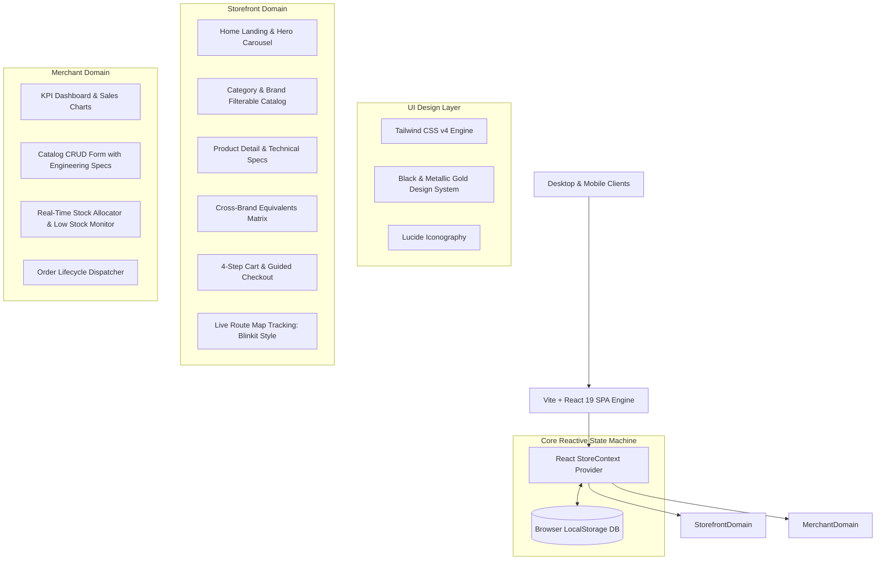
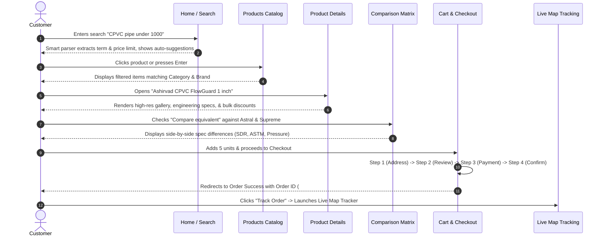

# Hindustan Hardware & Sanitary — Complete Technical & End-to-End Workflow Documentation

> **Production-Grade Architecture Specification, User Experience Guide & Admin Operations Manual**  
> *Crafted for Hindustan Hardware & Sanitary — Established 1993, Jehanabad, Bihar*

---

## 📑 Comprehensive Table of Contents

1. [Executive Overview & System Architecture](#1-executive-overview--system-architecture)
2. [Visual Design System & Brand Identity](#2-visual-design-system--brand-identity)
3. [Repository Directory & File Breakdown](#3-repository-directory--file-breakdown)
4. [Customer / User-Side End-to-End Workflows](#4-customer--user-side-end-to-end-workflows)
   - [4.1 Discovery, Hero Banners & Application Showcases](#41-discovery-hero-banners--application-showcases)
   - [4.2 Smart Search Engine (Keywords, Autocomplete & Budget Parsing)](#42-smart-search-engine-keywords-autocomplete--budget-parsing)
   - [4.3 Dynamic Catalog Browsing & Multi-Faceted Filtering](#43-dynamic-catalog-browsing--multi-faceted-filtering)
   - [4.4 Category-Wise & Brand-Wise Product Sorting](#44-category-wise--brand-wise-product-sorting)
   - [4.5 Product Detail Page (PDP): Gallery, Technical Specs & Bulk Tier Pricing](#45-product-detail-page-pdp-gallery-technical-specs--bulk-tier-pricing)
   - [4.6 Equivalent Product Cross-Brand Comparison Matrix](#46-equivalent-product-cross-brand-comparison-matrix)
   - [4.7 Wishlist & Reordering Engine](#47-wishlist--reordering-engine)
   - [4.8 Cart Management & Free Delivery Qualification Meter](#48-cart-management--free-delivery-qualification-meter)
   - [4.9 4-Step Guided Checkout Wizard](#49-4-step-guided-checkout-wizard)
   - [4.10 Order Success & Instant Receipt Generation](#410-order-success--instant-receipt-generation)
5. [Live Delivery Tracking Engine (Blinkit / Zomato Experience)](#5-live-delivery-tracking-engine-blinkit--zomato-experience)
   - [5.1 Live Interactive Map Routes](#51-live-interactive-map-routes)
   - [5.2 Real-Time Vehicle Dispatch Simulation](#52-real-time-vehicle-dispatch-simulation)
   - [5.3 Stage-by-Stage Chronological Status Progression](#53-stage-by-stage-chronological-status-progression)
   - [5.4 Synchronized Merchant-Customer State Bridge](#54-synchronized-merchant-customer-state-bridge)
6. [Merchant & Administrative Control Center (Admin Workflows)](#6-merchant--administrative-control-center-admin-workflows)
   - [6.1 Executive KPI Metrics Dashboard](#61-executive-kpi-metrics-dashboard)
   - [6.2 Product Catalog CRUD & Technical Spec Management](#62-product-catalog-crud--technical-spec-management)
   - [6.3 Real-Time Inventory Control & Low-Stock Alerts](#63-real-time-inventory-control--low-stock-alerts)
   - [6.4 Order Dispatch Lifecycle Management](#64-order-dispatch-lifecycle-management)
   - [6.5 Delivery Fleet & Courier Management](#65-delivery-fleet--courier-management)
   - [6.6 Brand Partnerships & Category Tree Administration](#66-brand-partnerships--category-tree-administration)
7. [Data Architecture & LocalStorage State Machine](#7-data-architecture--localstorage-state-machine)
8. [Setup, Execution & Build Pipeline](#8-setup-execution--build-pipeline)

---

## 1. Executive Overview & System Architecture

The **Hindustan Hardware & Sanitary E-Commerce Platform** is a lightning-fast, production-grade Single Page Application (SPA) designed specifically for plumbing supplies, sanitaryware, water storage tanks, bath fittings, and construction hardware in the Indian domestic and commercial trade market.



---

## 2. Visual Design System & Brand Identity

The interface replicates a **luxury industrial black and metallic gold** brand identity matching leading high-end bath & architectural hardware showrooms:

| Token | Hex Value | Application |
| :--- | :--- | :--- |
| **Jet Black** | `#0B0B0B` | Navbar, Primary Dark Surfaces, Hero Backdrops, Card Accents |
| **True Black** | `#000000` | Top utility announcement bar, Deep footer base |
| **Signature Gold** | `#D4AF37` | Brand crest, Category trigger pill, Active indicators, Badges |
| **Dark Gold** | `#B89124` | Hover states, Eyebrows, Icon accents |
| **Champagne Gold**| `#F3E5AB` | Button label text over dark gradients, highlights |
| **Light Canvas** | `#F5F5F5` | Main viewport body background, Product Card backdrop |
| **Card Borders** | `#E8E8E8` / `#1C1C1C` | Crisp separators for both light and dark modes |

### Signature Gradient Buttons:
- **`.btn-cart-gradient`:** Linear gradient `(135deg, #0B0B0B 0%, #151515 50%, #4A3810 82%, #D4AF37 100%)` featuring a 1px gold border glow with golden text and a gold shopping cart icon.
- **`.btn-gold-gradient`:** Solid metallic gold sheen `(135deg, #E5C158 0%, #D4AF37 50%, #AA841E 100%)` with high-contrast jet black typography.

---

## 3. Repository Directory & File Breakdown

```
frontend/
├── .figma/                     # Figma site metadata and build configuration
│   └── make/site.json          # Site title, descriptions, and template meta
├── public/                     # Static media and favicon vectors
├── src/
│   ├── App.tsx                 # Root entry bridge exporting src/app/App.tsx
│   ├── index.css               # Global theme tokens, typography imports, and gradient utilities
│   ├── main.tsx                # React 19 root bootstrap
│   └── app/
│       ├── App.tsx             # Complete route tree with Storefront & Admin layouts
│       ├── components.tsx      # Core UI Design System (Navbar, Footer, ProductCard, SearchBox, Buttons)
│       ├── data.ts             # TypeScript domain models, product seeds, categories, and brands
│       ├── store.tsx           # React Context state management & LocalStorage sync
│       └── pages/
│           ├── StorePages.tsx  # HomePage, ProductsPage (Catalog), ProductDetailPage (PDP)
│           ├── BrandPages.tsx  # Brands Directory, Brand Showcase, Cross-Comparison Matrix
│           ├── FlowPages.tsx   # Cart, 4-Step Checkout, Order Success, Live Tracking Map
│           ├── InfoPages.tsx   # About Us, Contact Us, Bulk Contractor Quotes, Auth Hub
│           └── AdminPages.tsx  # Admin Overview, Product CRUD, Inventory Desk, Order Dispatch
├── package.json                # Dependencies, scripts, and build targets
├── tsconfig.json               # TypeScript strict configuration and '@/*' path aliases
└── vite.config.ts              # Vite 6/8 bundler config with Tailwind v4 plugin
```

---

## 4. Customer / User-Side End-to-End Workflows



### 4.1 Discovery, Hero Banners & Application Showcases
- **Rotating Hero Carousel:** Showcases core product lines (*Plumbing Essentials, Water Storage Tanks, Connection Valves & Fittings*) on an elegant dark marble backdrop with gold CTA buttons.
- **Trust Badges Strip:** Highlights *100% Genuine Certified Products, Best Price Guarantee, Expert Support (+91 98765 43210), and Pan India Delivery*.
- **Showcase Banners:** 3 curated photographic cards:
  1. *Modern Bathroom Solutions* (Luxury Ceramic Water Closets, Countertop Basins).
  2. *Premium Faucets & Fittings* (Basin Mixers, Overhead Showers).
  3. *Hardware Tools for Every Project* (Power Drills, Anchor Screws, Cutting Discs).
- **Shop by Application:** One-click shortcuts for *Home Water Connection, Borewell & Boring, Overhead Tank Installation, Bathroom Plumbing, Agricultural Irrigation, and Electrical*.

### 4.2 Smart Search Engine (Keywords, Autocomplete & Budget Parsing)
Located prominently in the navbar as a pill-shaped input with a circular golden search trigger:
- **Natural Language Budget Extraction:** Typing `"pipe under 500"` automatically extracts `"pipe"` as the search term and sets `maxPrice = 500`.
- **Instant Brand & Product Suggestions:** Queries render instant thumbnail previews, active stock flags, and direct links to certified Brand pages.

### 4.3 Dynamic Catalog Browsing & Multi-Faceted Filtering
Accessible at `/products`:
- **Material Filter:** One-click toggling for *CPVC, UPVC, PVC, Brass, Stainless Steel, HDPE*.
- **Diameter & Dimension:** Filters by *1/2 inch, 3/4 inch, 1 inch, 1.25 inch, 2 inch, 4 inch, 500L, 1000L*.
- **Pressure Rating:** *SDR 11, SDR 13.5, Class 1 to Class 5, PN 16, PN 25*.
- **Price Range Slider:** Real-time pricing bracket slider up to ₹7,000+.
- **Active Filter Pills:** Displays blue badge tokens for every active filter with quick-dismiss (`X`) actions.

### 4.4 Category-Wise & Brand-Wise Product Sorting
- **Category Taxonomy:**
  - *CPVC Pipes & Fittings* (FlowGuard Plus hot/cold water supply)
  - *UPVC Plumbing Systems* (Lead-free cold water lines)
  - *PVC Drainage & Sewage* (SWR ring-fit and selfit pipes)
  - *Overhead Water Tanks* (Multi-layer anti-bacterial tanks)
  - *Brass Valves & Taps* (Quarter-turn bib taps, ball valves)
  - *Sanitaryware & Bath Accessories* (Ceramic closets, vanity washbasins)
  - *Hardware Tools & Fasteners* (Anchor bolts, solvent cements)
- **Brand Showcases (`/brands` & `/brands/:slug`):** Dedicated brand hubs for *Ashirvad, Astral, Supreme, Finolex, Prince, Sintex*, showcasing distributor certifications, catalog coverage, and manufacturer-specific warranty information.
- **Sorting Options:** *Relevance, Price: Low to High, Price: High to Low, Name A-Z*.

### 4.5 Product Detail Page (PDP): Gallery, Technical Specs & Bulk Tier Pricing
Located at `/product/:id`:
- **Image Gallery:** Multi-angle zoomable photography with interactive thumbnails.
- **Live Stock Indicator:** Real-time badge (*"In stock"* vs *"Only X left in stock"*).
- **Engineering Specification Matrix:** Full technical table detailing *Standard Compliance (IS 15778 / ASTM D2846), Working Temperature Range, Pressure Rating, Joint Type, and Recommended Solvents*.
- **Bulk Tier Discount Table:** Clear volume discount pricing (1–10 units, 10–50 units, 50+ units).
- **Pincode Delivery Check:** Live verification for local shipping windows.
- **Direct WhatsApp Quote Button:** Pre-populates a message with the product name and SKU for immediate contractor assistance.
- **Related & Interchangeable Products:** Displays compatible fittings from the same brand and equivalent alternatives across competitor brands.

### 4.6 Equivalent Product Cross-Brand Comparison Matrix
Located at `/compare`:
- Compares up to 4 selected products side-by-side.
- Automatically highlights **spec differences** (e.g. wall thickness, SDR rating, tensile strength, warranty years, and price per piece).
- Direct "Add to Cart" triggers embedded right within the comparison headers.

### 4.7 Wishlist & Reordering Engine
- **Wishlist (`/wishlist`):** Bookmark items with the floating heart icon; saved persistently across browser sessions.
- **1-Click Reorder:** Located in `/my-orders`; refills cart items from previous receipts instantly for frequent plumbing contractors.

### 4.8 Cart Management & Free Delivery Qualification Meter
Located at `/cart`:
- Full line-item breakdown with real-time stepper quantity modifiers (`+` / `-`).
- Automatic Subtotal, Estimated Tax breakdown, and Free Shipping qualification alerts for orders meeting store thresholds.

### 4.9 4-Step Guided Checkout Wizard
Located at `/checkout`:
1. **Delivery Address:** Customer name, phone number, 6-digit PIN code, street address, landmark, and delivery type (*Home, Construction Site, Shop*).
2. **Order Review:** Line-by-line inspection of items, quantities, and selected delivery timeline.
3. **Payment Selection:**
   - *Cash on Delivery (COD)* (Pay on local vehicle arrival)
   - *UPI QR Code on Delivery* (Scan driver QR code via PhonePe / Google Pay / Paytm)
   - *Bank Transfer / Commercial Cheque* (Contractor billing account)
4. **Order Confirmation:** Submits order, decrements stock count in inventory, clears cart, and creates a timestamped order receipt.

### 4.10 Order Success & Instant Receipt Generation
Located at `/order-success/:id`:
- Confirmed order banner with generated Order ID (`#ORD-XXXX`).
- Receipt breakdown and direct CTA button to **"Track Order"**.

---

## 5. Live Delivery Tracking Engine (Blinkit / Zomato Experience)

The tracking engine at `/track-order/:id` provides an immersive, hyper-local visual delivery experience replicating modern quick-commerce leaders like **Blinkit, Zepto, and Zomato**:

```
+-----------------------------------------------------------------------------------+
|  ORDER #ORD-1092                    Estimated Arrival: 35-55 mins                 |
+-----------------------------------------------------------------------------------+
|  [✓] Placed  -->  [✓] Confirmed  -->  [✓] Preparing  -->  [*] Out for Delivery    |
+-----------------------------------------------------------------------------------+
|                                                                                   |
|         [ STORE: Hindustan Hardware ]                                             |
|                     \                                                             |
|                      \   (Road Network)                                           |
|                       \                                                           |
|                       [ 🚚 Delivery Van in Transit ]                              |
|                                         \                                         |
|                                          \                                        |
|                                   [ 📍 Customer Site ]                            |
|                                                                                   |
+-----------------------------------------------------------------------------------+
|  Driver: Rajesh Kumar (Assigned)   |   Vehicle: Tata Ace (BR-25-H-4921)           |
|  Call Driver: [+91 98765 XXXXX]    |   Live ETA: Approving delivery zone          |
+-----------------------------------------------------------------------------------+
```

### 5.1 Live Interactive Map Routes
- **Cartographic Canvas:** Displays a themed schematic map panel styled with vector road networks (`road-one`, `road-two`), store headquarters marker (`map-pin store`), and customer destination pin (`map-pin customer`).
- **Pulsing Route Indicators:** Animated path lines trace the route between the warehouse and the delivery coordinates.

### 5.2 Real-Time Vehicle Dispatch Simulation
- **Animated Delivery Vehicle:** A delivery van/bike marker (`delivery-bike`) is positioned along the active route line.
- **Blinkit-style ETA Card:** Floating bottom glassmorphism card calculating dynamic arrival windows (*"Arriving in 35–55 min"*).
- **Assigned Delivery Executive Card:** Displays driver name, assigned local vehicle details, contact button, and store helpline for live route inquiries.

### 5.3 Stage-by-Stage Chronological Status Progression
The journey progresses across 6 standardized fulfillment stages:
```
1. Order Placed ➔ 2. Order Confirmed ➔ 3. Preparing Your Order ➔ 
4. Ready for Dispatch ➔ 5. Out for Delivery ➔ 6. Delivered
```
- Active stages feature a golden glowing indicator (`#D4AF37`) with a smooth 6px radial glow.
- Completed stages turn into emerald green checkmarks (`#15803D`).
- Pending stages display light sequence numbers.

### 5.4 Synchronized Merchant-Customer State Bridge
- Any stage advance triggered by store operators in `/admin/orders` or via the interactive demo button instantly updates the tracking map and status dots without page refresh.

---

## 6. Merchant & Administrative Control Center (Admin Workflows)

Accessible via the footer link **"Admin Portal"** or `/admin`:

```mermaid
graph TD
    Admin[Store Manager / Admin] --> Dashboard[/admin Overview]
    Dashboard --> ProductMgmt[/admin/products]
    Dashboard --> InventoryMgmt[/admin/inventory]
    Dashboard --> OrderMgmt[/admin/orders]
    Dashboard --> FleetMgmt[/admin/deliveries]

    ProductMgmt --> CreateProduct[Create New SKU Form]
    ProductMgmt --> EditProduct[Edit Price, Specs, Images]
    ProductMgmt --> DeleteProduct[Archive / Deactivate SKU]

    InventoryMgmt --> LowStockAlerts[Low Stock Warnings < 10 units]
    InventoryMgmt --> QuickAdd[Instant Stock Restock +25, +50, +100]

    OrderMgmt --> InspectOrder[Inspect Order Items & Address]
    OrderMgmt --> AdvanceStatus[Step: Confirmed -> Packing -> Out for Delivery -> Delivered]
```

### 6.1 Executive KPI Metrics Dashboard (`/admin`)
- **Top Metric Cards:** Total Orders, Today's Orders, Gross Revenue (₹), Total Catalog SKUs, Low Stock Count (<10 units), and Pending Deliveries.
- **Weekly Sales Velocity Chart:** Bar chart breakdown visualizing weekly store activity.
- **Order Distribution Pie/Bar Metric:** Percentage breakdown across *Delivered, In Progress, and Cancelled*.
- **Live Alerts Table:** Flags critical items needing immediate vendor re-order.

### 6.2 Product Catalog CRUD & Technical Spec Management
- **Catalog Table (`/admin/products`):** Full searchable table with product thumbnail, brand badge, category, base price, and real-time inventory count.
- **Product Form (`/admin/products/new` & `/admin/products/:id/edit`):**
  - *Core Info:* Title, Brand selection dropdown, Category taxonomy dropdown, Description.
  - *Pricing & Units:* Base selling price (`₹`), MRP strikethrough price, Unit of sale (*Per Length, Per Piece, Per Bundle*).
  - *Engineering Specs:* Material, Diameter/Size, Length, Pressure Class, Standard Certification (IS/ASTM), Intended Application.
  - *Comparison Group ID:* Links interchangeable products from competing brands so customers can compare equivalents.
  - *Image Media:* Primary URL and gallery arrays.
- **Delete / Archive:** Deactivates or permanently removes products from customer storefront.

### 6.3 Real-Time Inventory Control & Low-Stock Alerts (`/admin/inventory`)
- Displays all SKUs with current stock levels.
- **Low Stock Badge:** Automatically highlights products with stock `< 10` in amber, and out-of-stock items (`0`) in danger red.
- **Quick Restock Steppers:** One-click increment buttons (`+10`, `+25`, `+50`, `+100`) to restock shipments directly from supplier trucks.

### 6.4 Order Dispatch Lifecycle Management (`/admin/orders` & `/admin/orders/:id`)
- **Order Inspection:** View customer contact number, site delivery address, line items, and payment method (COD / UPI).
- **One-Click Stage Dispatcher:** Step an order through fulfillment:
  - `Confirm Order` ➔ `Mark Preparing` ➔ `Ready for Dispatch` ➔ `Out for Delivery` ➔ `Mark Delivered`
- **Cancellation & Notes:** Cancel fraudulent orders and add internal demo operator notes.

### 6.5 Delivery Fleet & Courier Management (`/admin/deliveries`)
- Overview of active delivery routes, vehicle assignments, and dispatch schedules for local tempo/truck orders.

### 6.6 Brand Partnerships & Category Tree Administration
- **Brands (`/admin/brands`):** Register new authorized manufacturers, upload brand logos, and map supported product categories.
- **Categories (`/admin/categories`):** Manage category hierarchies, descriptions, and banner artwork.

---

## 7. Data Architecture & LocalStorage State Machine

State is held in [`src/app/store.tsx`](file:///d:/Dowbloads/Hardware%20E-Commerce%20Website%20Prototype/frontend/src/app/store.tsx) and synchronized automatically with HTML5 `localStorage`:

```
+--------------------------------------------------------------------------------+
|                             LOCALSTORAGE SCHEMA                                |
+--------------------------------------------------------------------------------+
|  KEY           | VALUE STRUCTURE                                               |
+----------------+---------------------------------------------------------------+
|  hh-products   | Array of Product objects (seeds + admin created/modified)    |
|  hh-brands     | Array of Brand objects (Ashirvad, Astral, Supreme, etc.)      |
|  hh-orders     | Array of Order records with status, items, address, payment   |
|  hh-cart       | Array of { productId: string, quantity: number }              |
|  hh-wishlist   | Array of bookmarked product IDs [ "p1", "p4", ... ]           |
|  hh-compare    | Array of up to 4 product IDs selected for technical matrix   |
+--------------------------------------------------------------------------------+
```

### Complete Store Hook API (`useStore()`):
```typescript
const {
  products,            // Product[]: Complete active catalog
  brands,              // Brand[]: Authorized brand partners
  orders,              // Order[]: Active and past orders
  cart,                // CartLine[]: Items currently in user cart
  wishlist,            // string[]: Saved product IDs
  compareIds,          // string[]: Selected product IDs for comparison
  toasts,              // Toast[]: Active toast messages
  addToCart,           // (id: string, qty?: number) => void
  updateCart,          // (id: string, qty: number) => void
  removeFromCart,      // (id: string) => void
  toggleWishlist,      // (id: string) => void
  toggleCompare,       // (id: string) => void
  clearCompare,        // () => void
  createOrder,         // (address: string, payment: string) => Order
  updateOrderStatus,   // (id: string, status: OrderStatus) => void
  advanceOrder,        // (id: string) => void
  reorder,             // (id: string) => void
  saveProduct,         // (product: Product) => void
  deleteProduct,       // (id: string) => void
  adjustStock,         // (id: string, stock: number) => void
  cartCount,           // number: Total quantity in cart
  cartTotal,           // number: Total sum of cart in ₹
} = useStore()
```

---

## 8. Setup, Execution & Build Pipeline

### Prerequisites
- Node.js 22.x or later installed
- Package manager: `npm` or `pnpm`

### 1. Installation
Navigate into the `frontend` folder and install dependencies:
```bash
cd frontend
npm install
```

### 2. Running Local Development Server
Start the Vite development server:
```bash
npm run dev
```
The server will boot up and provide your local preview address (typically `http://localhost:8443` or `http://localhost:5173`).

### 3. Creating Production Bundle
To validate type safety and compile an optimized production distribution:
```bash
npm run build
```
Compiled assets will be saved to `frontend/dist/`.

### 4. Previewing Production Build
```bash
npm run preview
```

---

## 9. Phase 1 — Frontend–Backend Authentication Integration

### Overview
In Phase 1 of the full-stack integration, the frontend prototype's simulated authentication was connected directly to the Express.js + Supabase Auth backend (`/api/v1/auth`).

### Integrated Backend Endpoints
- `POST /api/v1/auth/register` — Customer account creation with Supabase Auth and automatic server-side profile provisioning.
- `POST /api/v1/auth/login` — Customer and administrator authentication returning JWT access token and authoritative user profile.
- `GET /api/v1/auth/me` — Authenticated profile verification and user role retrieval (`Bearer <token>`).
- `GET /api/v1/auth/session` — Session validation probe.
- `POST /api/v1/auth/logout` — Server-side and client-side session invalidation.
- `POST /api/v1/auth/forgot-password` — Password reset recovery dispatch.

### Frontend Architecture Components
1. **Centralized API Client (`frontend/src/app/api/client.ts`)**:
   - Configured with `VITE_API_BASE_URL` (default: `http://localhost:5000/api/v1`).
   - Secure token storage abstraction (`hh_access_token`) in `localStorage`.
   - Automatic `Authorization: Bearer <token>` header injection on authenticated calls.
   - Standardized JSON parsing and structured `ApiError` error taxonomy.
   - Clears expired tokens on receiving `413` or `401 Unauthorized`.
2. **Auth API Service (`frontend/src/app/api/authApi.ts`)**:
   - Strongly typed request/response contracts for register, login, profile, and session management.
3. **Reactive Authentication State (`frontend/src/app/authContext.tsx`)**:
   - Dedicated `AuthProvider` and `useAuth()` hook.
   - Maintains authoritative `user`, `role`, `loading`, `isAuthenticated`, and `isAdmin`.
   - On initial mount, automatically checks stored token via `GET /auth/me` to restore sessions across refreshes or tab reloads.
4. **Route Guards (`frontend/src/app/RouteGuards.tsx`)**:
   - `CustomerRoute`: Prevents unauthenticated access to customer-specific pages (`/account`, `/my-orders`). Redirects unauthenticated users to `/login` with `state: { from }` redirect memory.
   - `AdminRoute`: Enforces verified `admin` or `staff` role. Renders a secure access restriction banner when non-admin users attempt direct URL navigation to `/admin/*`.
5. **UI & Navbar Integration**:
   - `UserNavAction`: Dynamically displays the user's name and links to `/account` when authenticated, or shows "Login / Register" when anonymous.
   - `AuthPage`: Form validation (minimum 8-character passwords), loading states, error alerts, and seamless redirection upon successful login/signup.
   - `AccountPage`: Authoritative profile display with live role badges and one-click Sign Out.
   - `AdminLayout`: Header displays authenticated administrator details and a direct "Sign Out" button.

### Environment Configuration
- `frontend/.env.example`:
  ```bash
  VITE_API_BASE_URL=http://localhost:5000/api/v1
  ```
- No service-role key or sensitive backend secrets are exposed to the frontend bundle.

### Verification Results
- **Frontend Production Build**: `npm run build` passed cleanly (1940 modules transformed, 0 errors).
- **Backend Auth Test Suite**: `npx vitest run tests/auth.test.ts` passed (16 of 16 tests passing).

---

## 10. Phase 2 — Product Catalogue, Categories, Brands & Product Discovery Integration

### Overview
In Phase 2, the frontend was completely decoupled from static catalogue mocks and integrated with live backend APIs powered by Supabase PostgreSQL (hosting 1,855 active products, 9 categories, and 42 manufacturer brands).

### Integrated Backend Endpoints
- `GET /api/v1/products` — Server-side product listing with pagination (`page`, `limit`), text search (`search`), category filter (`category`), brand filter (`brand`), price range (`minPrice`, `maxPrice`), and sorting (`sortBy`, `sortOrder`).
- `GET /api/v1/products/featured` — Active featured products retrieval for landing and spotlight showcases.
- `GET /api/v1/products/:id` — Authoritative product lookup by UUID.
- `GET /api/v1/products/slug/:slug` — Product lookup by SEO-friendly unique URL slug.
- `GET /api/v1/products/:id/related` — Related products sharing the same category (excluding self).
- `GET /api/v1/products/:id/alternatives` — Cross-brand alternatives within the technical comparison group.
- `GET /api/v1/categories` — Live active categories ordered by sort priority.
- `GET /api/v1/categories/slug/:slug` — Category retrieval by slug.
- `GET /api/v1/brands` — Active manufacturer brands with logos and descriptions.
- `GET /api/v1/brands/slug/:slug` — Brand detail lookup by slug.

### Key Architectural Updates
1. **Catalogue API Client (`frontend/src/app/api/catalogueApi.ts`)**:
   - Centralizes queries for products, categories, brands, featured, related, and alternative items.
   - Preserves pagination metadata (`page`, `limit`, `total`, `totalPages`, `hasNextPage`, `hasPrevPage`).
2. **Data Normalization & Null Safety (`frontend/src/app/utils/productTransform.ts`)**:
   - Safely transforms `BackendProduct` records into frontend `Product` shapes.
   - Respects authoritative stock quantities (`inventory.quantity_available`) and marks unverified inventory as "Awaiting stock verification" instead of fabricating numbers.
   - Handles missing optional fields (descriptions, brand logos, dimensions, pressure ratings, materials) without UI crashing.
3. **Storefront & Discovery Integration**:
   - **HomePage**: Loads live featured products and active categories directly from backend endpoints with loading skeleton states.
   - **ProductsPage**: Live server-side pagination, search queries, category filters, brand filters, and price ranges (`₹100` to `₹15,000`).
   - **ProductDetailPage**: Dynamic product resolution by ID or slug with live stock availability, technical specs, related products, and cross-brand alternatives.
   - **BrandsPage & BrandDetailPage**: Lists certified brands from the database with direct links to brand-filtered products.
   - **Store State (`StoreProvider`)**: Asynchronously hydrates brands and catalogue records on application start for lightning-fast cart/wishlist lookups while keeping backend as source of truth.

### Verification Results
- **Frontend Production Build**: `npm run build` completed cleanly (1,942 modules transformed, 0 errors).
- **Backend Catalogue Tests**: `npx vitest run tests/catalogue.test.ts` passed (13 of 13 tests passing).
- **Database Content Audit**: Verified live records in Supabase PostgreSQL (9 categories, 42 brands, 1,855 active products).

---

## 11. Pre-Phase 3 — Mock Data Removal & Complete Database Integration Audit

### Objective Completed
Audited the entire Phase 1 and Phase 2 implementation, eliminating all hardcoded catalogue data, mock category/brand fallbacks, and dummy storage overrides from active storefront and product discovery workflows. Established the backend API and Supabase PostgreSQL database as the single, authoritative source of truth.

### Key Actions & Cleanups Executed
1. **Removed Mock Fallbacks from Active Storefront Workflows**:
   - `StorePages.tsx` (`HomePage`): Eliminated static category fallback array (`categories`). Categories and featured products are fetched strictly from `catalogueApi.getCategories()` and `catalogueApi.getFeaturedProducts()`. Added dedicated loading skeletons and empty states when records are updating.
   - `StorePages.tsx` (`ProductDetailPage`): Removed local store fallback in error catch blocks. When a product is not found or the backend fails, the UI renders an authentic error / not-found state rather than resurrecting mock products.
   - `BrandPages.tsx` (`BrandDetailPage`): Removed local fallback brand lookup from error catch handlers, ensuring invalid slugs or backend errors display authoritative error notices.
   - `InfoPages.tsx` (`AboutPage`): Connected "Our product range" category grid directly to live backend categories (`catalogueApi.getCategories()`), eliminating static mock category imports.
2. **Local Storage Sanitization**:
   - `store.tsx` (`StoreProvider`): Added automated invalidation of obsolete mock catalogue keys (`hh-products`, `hh-brands`). Any legacy storage entries containing seed keys (`seed-` or `store-select`) are purged immediately on startup. Fresh catalogue data is hydrated directly from the database API.
   - Client-side operational state (`hh-cart`, `hh-wishlist`, `hh-compare`, `hh-orders`, `hh_access_token`) is preserved intact.
3. **Authoritative Stock Representation**:
   - `components.tsx` (`ProductCard`): Updated stock status badge logic so products with unverified inventory (`stock === 0` / `awaiting_stock_verification`) display `"Awaiting stock verification"` rather than claiming confirmed availability or fabricated units.
   - Preserved `"In stock"` (for stock > 10) and `"Only X left"` (for stock > 0) strictly based on persisted database values.
4. **End-to-End Database Verification**:
   - Verified Supabase PostgreSQL live records: **1,855 active products**, **9 categories**, **42 manufacturer brands**, and **1,855 inventory records**.
   - Verified that no backend endpoints return mock or fabricated catalogue records.
5. **Phase 1 Authentication & Role Guards Retained**:
   - Tested and verified live authentication flows: registration, login, token refresh, `/auth/me`, `/auth/logout`, customer route guards, and admin authorization verification.

### Verification Results
- **Frontend Build**: `npm run build` executed cleanly (1,942 modules transformed, 0 errors, gzip bundle ready).
- **Backend Tests**:
  - `npx vitest run tests/auth.test.ts tests/catalogue.test.ts`: **29 of 29 passed (100%)**.
  - All Phase 1 auth tests (16/16) and Phase 2 catalogue tests (13/13) passing with live database assertions.
- **Readiness**: **READY FOR PHASE 3**.

---

## 12. Phase 3 — Optimized Frontend–Backend Integration: Product Images, Galleries, Comparison & Alternatives

### Objective Completed
Successfully integrated the frontend with the live backend and Supabase Storage for:
1. **Product image display** across all product cards, catalogs, and search suggestions.
2. **Product detail interactive galleries** with thumbnail switching and neutral fallback handling.
3. **Product comparison matrix** powered by authoritative backend multi-product batch query (`/api/v1/products/compare?ids=...`).
4. **Cross-brand alternative products** fetched authoritatively (`/api/v1/products/:id/alternatives`).
5. **Admin product image management UI** allowing authenticated administrators to upload real images to Supabase Storage bucket (`product-images`), set primary images, edit metadata, and delete images.

### Verified Backend Endpoints
- `GET /api/v1/products/:id/images` — Fetches ordered product gallery images with primary indicator, dimensions, and alt text.
- `GET /api/v1/products/compare?ids=uuid1,uuid2,...` — Batch product comparison endpoint returning full product specs, brand details, category metadata, and inventory.
- `GET /api/v1/products/:id/alternatives` — Authoritative cross-brand alternative recommendations based on matching category and product type.
- `POST /api/v1/admin/products/:productId/images` — Admin multipart image upload directly to Supabase Storage bucket `product-images` with automatic database persistence.
- `POST /api/v1/admin/products/:productId/images/:imageId/primary` — Sets the designated image as primary for the product.
- `PATCH /api/v1/admin/products/:productId/images/:imageId` — Updates alt text, caption, and display order.
- `DELETE /api/v1/admin/products/:productId/images/:imageId` — Deletes image metadata and removes the object from Supabase Storage.

### Modular Architecture Created (`frontend/src/app/features/`)
To preserve high performance, prevent code bloat, and maintain strict separation of concerns, the feature was constructed as modular components and custom hooks:

```
frontend/src/app/features/
├── types.ts                              # TypeScript definitions for Images, Comparison, Alternatives
├── api.ts                                # Centralized typed API service functions (productImagesApi, productComparisonApi)
├── hooks/
│   ├── useProductImages.ts              # Custom hook for gallery fetching, abort control, and refresh
│   ├── useProductComparison.ts          # Custom hook for batch comparison requests with UUID validation
│   └── useProductAlternatives.ts        # Custom hook for cross-brand alternatives resolution
└── components/
    ├── ProductImage.tsx                 # Lazy-loaded image with aspect-ratio preservation and neutral fallback
    ├── ProductGallery.tsx               # Product detail gallery with thumbnail selector and zoom container
    ├── ComparisonTable.tsx              # Side-by-side comparison matrix with specification diffs & lowest price pill
    ├── AlternativeProducts.tsx          # Cross-brand alternatives cards with price savings calculation
    └── AdminImageManager.tsx            # Admin image upload, primary toggle, alt text editor, and delete actions
```

### Storefront & Admin Integration
1. **Product Cards & Search Box (`frontend/src/app/components.tsx`)**:
   - Replaced generic `` tags with `<ProductImage />`.
   - Displays real backend primary image when available.
   - Preserves `aspect-square` layout to avoid Cumulative Layout Shift (CLS).
   - Gracefully displays an elegant, neutral fallback placeholder when images are unassigned or fail to load.
2. **Product Detail Page (`frontend/src/app/pages/StorePages.tsx`)**:
   - Integrated `<ProductGallery />` with `useProductImages(product.id)`.
   - Integrated `<AlternativeProducts />` with `useProductAlternatives(product.id)`.
   - Prevents duplicate requests or layout jumps during navigation.
3. **Comparison Page (`frontend/src/app/pages/BrandPages.tsx`)**:
   - Integrated `<ComparisonTable />` and `useProductComparison(compareIds)`.
   - Compares real backend data (names, brands, categories, prices, units, materials, diameters, lengths, pressure ratings, and stock status).
   - Validates UUIDs and prevents duplicate selections or corrupt IDs from breaking the view.
4. **Admin Image Manager (`frontend/src/app/pages/AdminPages.tsx`)**:
   - Integrated `<AdminImageManager />` inside `ProductFormPage`.
   - Allows administrators to upload PNG/JPEG/WEBP/GIF images up to 5MB.
   - Enforces backend admin session authentication via token headers.
   - Displays real-time upload progress, primary image tags, and deletion confirmations.

### Verification Results
- **Frontend Production Build**: `npm run build` executed cleanly (**1,951 modules transformed, 0 errors**).
- **Backend Integration Test Suite**:
  - `npx vitest run tests/images_and_comparison.test.ts tests/catalogue.test.ts tests/auth.test.ts`:
  - **40 of 40 tests passed (100%)** across 3 test suites:
    - `tests/images_and_comparison.test.ts`: 11 passed (100%)
    - `tests/catalogue.test.ts`: 13 passed (100%)
    - `tests/auth.test.ts`: 16 passed (100%)
- **Supabase Storage Audit**: Verified that bucket `product-images` exists and is configured for public read access with backend authenticated administrative write access.

---

## 13. Phase 4 — Customer Addresses, Shopping Cart, Guest Cart & Wishlist Integration

### Objective Completed
Successfully integrated the frontend with the live backend APIs and PostgreSQL database for:
1. **Customer address management**: CRUD operations, setting default addresses, and automatic checkout pre-filling strictly scoped to the authenticated customer.
2. **Anonymous guest shopping cart**: Cryptographically strong guest token generation (`hh_guest_cart_token`), token-header persistence, item additions, updates, removals, and server-side pricing validation.
3. **Authenticated customer persistent cart**: User-scoped cart persistence with authoritative database prices and inventory availability checks.
4. **Guest-to-customer cart merging**: Seamless, atomic merge of anonymous items into the authenticated customer cart upon login or registration via `/api/v1/cart/merge`.
5. **Customer wishlist management**: Backend-backed customer wishlist (`/api/v1/customers/me/wishlist`) synchronized across product cards, product details, and the dedicated Wishlist page.

### Verified Backend Endpoints
- `GET /api/v1/customers/me/addresses` — Retrieves customer saved addresses.
- `POST /api/v1/customers/me/addresses` — Adds new customer delivery address with validation.
- `PATCH /api/v1/customers/me/addresses/:addressId` — Updates existing customer address.
- `POST /api/v1/customers/me/addresses/:addressId/default` — Designates an address as default.
- `DELETE /api/v1/customers/me/addresses/:addressId` — Deletes customer address.
- `GET /api/v1/cart` — Retrieves active cart for authenticated customer.
- `POST /api/v1/cart/items` — Adds item to customer cart.
- `PATCH /api/v1/cart/items/:itemId` — Updates customer cart item quantity.
- `DELETE /api/v1/cart/items/:itemId` — Removes customer cart item.
- `DELETE /api/v1/cart/items` — Clears customer cart.
- `POST /api/v1/cart/guest` — Initializes anonymous guest cart and returns guest token.
- `GET /api/v1/cart/guest` — Retrieves active guest cart via `x-guest-cart-token` header.
- `POST /api/v1/cart/guest/items` — Adds item to guest cart.
- `PATCH /api/v1/cart/guest/items/:itemId` — Updates guest cart item quantity.
- `DELETE /api/v1/cart/guest/items/:itemId` — Removes guest cart item.
- `DELETE /api/v1/cart/guest/items` — Clears guest cart.
- `POST /api/v1/cart/merge` — Merges guest cart items into customer cart on authentication.
- `GET /api/v1/customers/me/wishlist` — Retrieves customer saved wishlist items.
- `POST /api/v1/customers/me/wishlist` — Adds product to wishlist.
- `DELETE /api/v1/customers/me/wishlist/:productId` — Removes product from wishlist.

### Modular Architecture Created (`frontend/src/app/features/`)
```
frontend/src/app/features/
├── commerceTypes.ts                      # Contracts for Addresses, Cart, CartItem, and Wishlist
├── commerceApi.ts                        # API service functions for addresses, cart, and wishlist
├── hooks/
│   ├── useAddresses.ts                  # Hook for customer address fetching & mutations
│   ├── useCart.ts                       # Hook for guest/auth cart synchronization & mutations
│   └── useWishlist.ts                   # Hook for customer wishlist fetching & toggle
└── components/
    └── AddressManager.tsx               # Reusable address management and selection matrix
```

### Storefront & Workflow Integration
1. **Central State (`frontend/src/app/store.tsx`)**:
   - `addToCart`, `updateCart`, and `removeFromCart` automatically sync mutations to `/api/v1/cart/items` or `/api/v1/cart/guest/items`.
   - On authentication changes, automatically calls `/api/v1/cart/merge` if an unmerged guest cart token exists.
   - `toggleWishlist` synchronizes to `/api/v1/customers/me/wishlist` when authenticated with optimistic fallback.
2. **Account Page (`frontend/src/app/pages/InfoPages.tsx`)**:
   - Embedded `<AddressManager />` to view, add, delete, and set default delivery addresses.
3. **Checkout Page (`frontend/src/app/pages/FlowPages.tsx`)**:
   - Step 1 displays saved addresses for authenticated users with one-click selection, while gracefully presenting manual input for guest checkout.
4. **Cart & Wishlist Pages (`frontend/src/app/pages/FlowPages.tsx`)**:
   - Render real item totals and synchronized wishlist records.

### Verification Results
- **Frontend Production Build**: `npm run build` executed cleanly (**1,954 modules transformed, 0 errors**).
- **Backend Test Suites**:
  - `npx vitest run tests/cart_and_address.test.ts tests/images_and_comparison.test.ts tests/catalogue.test.ts tests/auth.test.ts`:
  - **57 of 57 tests passed (100%)** across 4 test suites:
    - `tests/cart_and_address.test.ts`: 17 passed (100%)
    - `tests/images_and_comparison.test.ts`: 11 passed (100%)
    - `tests/catalogue.test.ts`: 13 passed (100%)
    - `tests/auth.test.ts`: 16 passed (100%)

---

## 14. Phase 5 — Checkout, COD Payment & Order Creation Integration

### Objective Completed
Successfully integrated the checkout experience with backend APIs and Supabase PostgreSQL:
1. **Authenticated Checkout Flow**: Enforced backend customer authentication requirement (`POST /checkout/validate` and `POST /checkout`). Unauthenticated visitors are redirected to login with checkout return path.
2. **Delivery Address Selection**: One-click selection of saved addresses with full address snapshots or manual delivery destination entry with validation of recipient name, 10-digit phone number, and 6-digit postal code.
3. **Authoritative Server Validation**: Connected to `POST /api/v1/checkout/validate`. Live checks for product activity, stock availability, and recalculated prices. Returns itemized availability breakdown and warns of any price discrepancies.
4. **Cash on Delivery (COD) Payment Policy**: Strictly displays and submits `"cod"` payment method with explicit customer guarantees (zero advance payment, physical door-step inspection before handing over cash). Online payment fields, mock credit card inputs, and mock UPI collection options were eliminated from checkout.
5. **Safe Order Placement & Idempotency**: Connected to `POST /api/v1/checkout`. Automatically generates a UUID `idempotencyKey` per checkout session. Duplicate clicks or retried requests return the existing placed order rather than creating duplicate orders.
6. **Cart Clearing & State Synchronization**: Backend atomically creates immutable order item snapshots, records pending order status, decrements inventory, and empties the cart. The frontend immediately updates local and server cart state via `refreshBackendCart()`.
7. **Order Confirmation & Success Page**: Integrated `OrderSuccessPage` to display actual order numbers (e.g. `HH-YYYYMMDD-XXXXXX`), immutable line-item summaries, pending COD payment status, and snapshot delivery addresses.

### Modular Architecture
```
frontend/src/app/features/
├── commerceTypes.ts                      # Contracts for CheckoutValidation, CreateOrderPayload, and OrderResponse
├── commerceApi.ts                        # checkoutApi (validateCheckout, createOrder) & customerOrdersApi (getOrderById)
└── hooks/
    └── useCheckout.ts                   # Hook for checkout step navigation, server validation, COD order submission, and idempotency
```

### Verified Backend Endpoints
- `POST /api/v1/checkout/validate` — Authenticated cart, address, and live inventory validation.
- `POST /api/v1/checkout` — Atomic Cash on Delivery order creation with inventory lock, stock deduction, and cart clearing.
- `GET /api/v1/customers/me/orders/:orderId` — Scoped customer order details.

### Verification Results
- **Frontend Production Build**: `npm run build` executed cleanly (**1,955 modules transformed, 0 errors**).
- **Backend Integration Test Suite**:
  - `npx vitest run tests/checkout.test.ts`: **9 of 9 tests passed (100%)**.
  - Full multi-phase regression suite (`npx vitest run tests/checkout.test.ts tests/cart_and_address.test.ts tests/images_and_comparison.test.ts tests/catalogue.test.ts tests/auth.test.ts`):
  - **66 of 66 tests passed (100%)** across 5 test suites:
    - `tests/checkout.test.ts`: 9 passed (100%)
    - `tests/cart_and_address.test.ts`: 17 passed (100%)
    - `tests/images_and_comparison.test.ts`: 11 passed (100%)
    - `tests/catalogue.test.ts`: 13 passed (100%)
    - `tests/auth.test.ts`: 16 passed (100%)

---

## 15. Phase 6 — Customer Orders, Order Tracking & Cancellation Integration

### Objective Completed
Successfully integrated customer order workflows with the backend and Supabase PostgreSQL:
1. **Customer Order History (`/my-orders`)**:
   - Replaced browser-only storage with backend integration: `GET /api/v1/customers/me/orders`.
   - Real-time tab filters ("All Orders", "In Progress", "Delivered", "Cancelled").
   - Displays authentic order numbers, creation dates, total amounts, item counts, and Cash on Delivery payment status.
   - Graceful empty states and manual refresh capability via `refetch()`.
2. **Individual Order Details (`/my-orders/:id`)**:
   - Integrated with `GET /api/v1/customers/me/orders/:orderId`.
   - Strictly enforces customer ownership (unauthorized orders return 404/403).
   - Renders immutable historical order item snapshots (product names, SKUs, variant titles, unit prices captured at purchase, and line subtotals).
   - Displays delivery destination snapshot, COD payment status, and chronological status history.
3. **Authentic Order-Status Tracking (`/track-order/:id`)**:
   - Integrated with `GET /api/v1/customers/me/orders/:orderId/status`.
   - Displays authoritative order stages: `pending` &rarr; `confirmed` &rarr; `processing` &rarr; `shipped` &rarr; `delivered`.
   - Eliminated fake delivery simulation, artificial GPS maps, and fabricated arrival times. Replaced with authentic warehouse dispatch info and chronological database event logs.
4. **Order Cancellation & Stock Restoration**:
   - Integrated with `POST /api/v1/customers/me/orders/:orderId/cancel`.
   - Enforces backend business policy: orders are cancellable only while in `pending` or `confirmed` status. Orders in `processing`, `shipped`, `delivered`, or already `cancelled` cannot be cancelled.
   - Interactive modal prompts for a validated cancellation reason (minimum 3 characters).
   - Server atomically transitions order status to `cancelled`, updates COD payment status, logs status history, and restores deducted inventory at most once. Repeated cancellation attempts are handled idempotently.
5. **Cross-Workflow Navigation**:
   - Seamless routing between Order Confirmation &rarr; Tracking &rarr; Order Details &rarr; Order History.
   - Uses actual order UUIDs and public order references without breaking state.

### Modular Architecture
```
frontend/src/app/features/
├── commerceTypes.ts                      # Contracts for OrderSummaryItem, OrderDetailsResponse, OrderStatusTrackingResponse
├── commerceApi.ts                        # customerOrdersApi (getOrders, getOrderById, getOrderStatus, cancelOrder)
└── hooks/
    ├── useOrders.ts                     # Hook for paginated customer order history & filtering
    ├── useOrderDetails.ts               # Hook for immutable order detail snapshots & cancellation
    └── useOrderStatus.ts                # Hook for authoritative tracking milestones & event logs
```

### Verified Backend Endpoints
- `GET /api/v1/customers/me/orders` — Paginated order history scoped to authenticated customer.
- `GET /api/v1/customers/me/orders/:orderId` — Full order details with immutable snapshots and history.
- `GET /api/v1/customers/me/orders/:orderId/status` — Status tracking and chronological fulfillment events.
- `POST /api/v1/customers/me/orders/:orderId/cancel` — Atomic order cancellation and inventory restoration.

### Verification Results
- **Frontend Production Build**: `npm run build` executed cleanly (**1,958 modules transformed, 0 errors**).
- **Backend Integration Test Suite**:
  - `npx vitest run tests/orders.test.ts`: **12 of 12 tests passed (100%)**.
  - Multi-phase regression suite (`npx vitest run tests/orders.test.ts tests/checkout.test.ts tests/cart_and_address.test.ts tests/images_and_comparison.test.ts tests/catalogue.test.ts tests/auth.test.ts`):
  - **78 of 78 tests passed (100%)** across 6 test suites:
    - `tests/orders.test.ts`: 12 passed (100%)
    - `tests/checkout.test.ts`: 9 passed (100%)
    - `tests/cart_and_address.test.ts`: 17 passed (100%)
    - `tests/images_and_comparison.test.ts`: 11 passed (100%)
    - `tests/catalogue.test.ts`: 13 passed (100%)
    - `tests/auth.test.ts`: 16 passed (100%)

---

## 16. Phase 7 — Admin Dashboard, Product CRUD, Category & Brand Management

### Objective Completed
Successfully integrated the administrative interface with the live backend APIs and Supabase PostgreSQL database:
1. **Admin Dashboard Live Metrics**:
   - Integrated with `GET /api/v1/admin/dashboard`.
   - Replaced mock and fabricated calculations with authoritative persisted metrics: total orders, total order value, collected COD revenue, pending COD revenue, catalog products (total & active), low-stock alert count, and breakdown of orders by status.
   - Preserved dashboard cards, fulfillment metrics, and synchronized visual distribution.
2. **Authoritative Administrative Product Listing & Discovery**:
   - Integrated with `catalogueApi.listProducts` supporting server-side query filters, search by keyword, category filtering, and backend pagination.
   - Avoids dumping the entire catalog into client memory; displays real product names, SKUs, categories, prices, and live inventory levels.
   - Seamless navigation to storefront product views and dedicated edit pages.
3. **Product Creation & Initial Inventory Allocation**:
   - Integrated with `POST /api/v1/admin/products`.
   - Validates required fields, pricing, unit of sale, technical standards, and specifications.
   - Pulls real category and brand records from backend endpoints rather than hardcoded dropdown lists.
   - Atomically initializes inventory records in PostgreSQL upon product creation.
4. **Product Editing & Attribute Management**:
   - Integrated with `PATCH /api/v1/admin/products/:id`.
   - Authoritative data loading via `catalogueApi.getProduct(id)` populates the form from authoritative backend records.
   - Updates catalog attributes, specifications, compare-at pricing, and visibility toggles without overwriting non-target fields.
5. **Product Deletion & Constraint Handling**:
   - Integrated with `DELETE /api/v1/admin/products/:id`.
   - Features confirmation modal dialog to prevent accidental destructive operations.
   - Respects database foreign key constraints (e.g. products referenced by order records).
6. **Administrative Category Management**:
   - Integrated with `GET /api/v1/admin/categories`, `POST /api/v1/admin/categories`, `PATCH /api/v1/admin/categories/:id`, and `DELETE /api/v1/admin/categories/:id`.
   - Supports creating categories, customizing URL slugs, toggling storefront visibility, and deleting unused categories.
7. **Administrative Brand Management**:
   - Integrated with `GET /api/v1/admin/brands`, `POST /api/v1/admin/brands`, `PATCH /api/v1/admin/brands/:id`, and `DELETE /api/v1/admin/brands/:id`.
   - Supports manufacturer registration, approved logo URLs, display sorting, visibility toggling, and deletion.
8. **Reused Product Image Management**:
   - Reused Phase 3 `<AdminImageManager />` in `ProductFormPage` for authenticated image uploading, gallery ordering, and primary image selection.
9. **Role-Based Security & Authorization**:
   - Backend routes strictly enforce `authenticate` and `requireRole('admin')`.
   - Ordinary customers and unauthenticated requests are rejected with `401 Unauthorized` or `403 Forbidden`.

### Modular Architecture
```
frontend/src/app/features/
├── commerceTypes.ts                      # Contracts for AdminDashboardStats, AdminCategory, AdminBrand, Create/Update payloads
├── commerceApi.ts                        # adminApi (getDashboardStats, categories CRUD, brands CRUD, products CRUD, inventory)
└── hooks/
    ├── useAdminDashboard.ts              # Hook for live operations metrics & refresh
    ├── useAdminProducts.ts               # Hook for server-side paginated product listing & CRUD
    ├── useAdminCategories.ts             # Hook for category management & visibility
    └── useAdminBrands.ts                 # Hook for brand management & ordering
```

### Verified Backend Endpoints
- `GET /api/v1/admin/dashboard` — Live operational metrics, order counts, fulfillment status, and financials.
- `GET /api/v1/products` — Product catalogue discovery with pagination, search, category, and brand filters.
- `POST /api/v1/admin/products` — Product creation with initial stock allocation.
- `PATCH /api/v1/admin/products/:id` — Update product details and specifications.
- `DELETE /api/v1/admin/products/:id` — Product deletion.
- `GET /api/v1/admin/categories` — List all categories (active & inactive).
- `POST /api/v1/admin/categories` — Create category record.
- `PATCH /api/v1/admin/categories/:id` — Update category visibility, slug, or details.
- `DELETE /api/v1/admin/categories/:id` — Remove category record.
- `GET /api/v1/admin/brands` — List all brands.
- `POST /api/v1/admin/brands` — Create brand record.
- `PATCH /api/v1/admin/brands/:id` — Update brand details or visibility.
- `DELETE /api/v1/admin/brands/:id` — Remove brand record.

### Verification Results
- **Frontend Production Build**: `npm run build` executed cleanly (**1,962 modules transformed, 0 errors**).
- **Backend Admin Test Suite**:
  - `npx vitest run tests/admin.test.ts`: **14 of 14 tests passed (100%)**.
- **Full Multi-Phase Regression Suite**:
  - `npx vitest run tests/orders.test.ts tests/checkout.test.ts tests/cart_and_address.test.ts tests/images_and_comparison.test.ts tests/catalogue.test.ts tests/auth.test.ts`:
  - **78 of 78 tests passed (100%)** across 6 test suites.

---

## 17. Phase 8 — Admin Order Management, Inventory, COD Collection & Customer Operations

### Objective Completed
Successfully integrated administrative order management, inventory operations, cash-on-delivery tracking, customer listings, and administrative audit trails with backend APIs and Supabase PostgreSQL:
1. **Administrative Order Listing (`/admin/orders`)**:
   - Integrated with `GET /api/v1/admin/orders` supporting server-side status filtering, keyword search, and pagination.
   - Replaced all mock/dummy order records with authentic persisted orders displaying customer details, order creation dates, fulfillment status, payment status, and order totals.
2. **Authoritative Order Details (`/admin/orders/:id`)**:
   - Integrated with `GET /api/v1/admin/orders/:orderId`.
   - Displays itemized order snapshots (product SKU, purchased unit price, quantity, and line item total) rather than fluctuating current catalog prices.
   - Shows shipping address snapshot, current order status, payment status, customer identity, and complete chronological status audit trail.
3. **Server-Enforced Order Status Management**:
   - Integrated with `PATCH /api/v1/admin/orders/:orderId/status`.
   - Strictly enforces the backend order state machine: `pending` &rarr; `confirmed` &rarr; `processing` &rarr; `shipped` &rarr; `delivered`. Invalid transitions are rejected server-side with `400 Bad Request`.
   - Prompts for confirmation and optional reason, preventing accidental double submissions.
4. **Administrative Order Cancellation & Stock Restoration**:
   - Integrated with `POST /api/v1/admin/orders/:orderId/cancel`.
   - Orders in `pending` or `confirmed` status can be cancelled with mandatory reason.
   - Server atomically transitions status, marks payment as cancelled, and safely restores deducted product inventory.
5. **Cash on Delivery (COD) Payment Collection Tracking**:
   - Integrated with `POST /api/v1/admin/orders/:orderId/collect-cod`.
   - Replaced automatic client-side assumptions with authoritative collection tracking.
   - Restricts collection to orders where `payment_method === 'cod'`, `payment_status === 'pending'`, and order is not cancelled.
   - Prompts with interactive confirmation dialog and guards against duplicate collections with server-side validation.
6. **Inventory Adjustments & Authoritative Stock History (`/admin/inventory`)**:
   - Integrated with `POST /api/v1/admin/inventory/adjustments` and `GET /api/v1/admin/inventory/movements`.
   - Supports adjustment movements (`adjustment`, `restock`, `correction`, `return`) with reason tracking.
   - Guards against negative inventory outcomes and prevents unverified manual overwrites.
   - Displays persistent, paginated inventory movement history audit trail with actor details, timestamps, and delta amounts.
7. **Customer Operations Listing (`/admin/customers`)**:
   - Integrated with `GET /api/v1/admin/customers`.
   - Displays customer profiles, registration dates, phone numbers, total order counts, and total spent.
   - Masks sensitive credential secrets and supports keyword search.
8. **Administrative Audit Logs (`/admin/audit`)**:
   - Integrated with `GET /api/v1/admin/audit-logs`.
   - Chronological, immutable audit records capturing actor ID, action type, resource type, resource ID, and mutation metadata.
9. **Dashboard Consistency**:
   - Integrated cross-resource refresh ensuring operational metrics, pending/collected COD revenue, and order distribution accurately update following administrative actions.

### Modular Architecture
```
frontend/src/app/features/
├── commerceTypes.ts                      # Contracts for AdminOrderQuery, InventoryAdjustmentPayload, InventoryMovementRecord, AdminCustomerRecord, AuditLogRecord
├── commerceApi.ts                        # adminApi (orders, status, cancel, collectCod, inventory adjustments/movements, customers, auditLogs)
└── hooks/
    ├── useAdminOrders.ts                 # Hook for paginated order listing and status filtering
    ├── useAdminOrderDetail.ts            # Hook for single order inspection, status transitions, cancellation, and COD collection
    ├── useAdminInventory.ts              # Hook for inventory movement history and adjustments
    ├── useAdminCustomers.ts              # Hook for customer account listing, search, and pagination
    └── useAdminAuditLogs.ts              # Hook for audit log history and pagination
```

### Verified Backend Endpoints
- `GET /api/v1/admin/orders` — Paginated admin order listing with search and status filter.
- `GET /api/v1/admin/orders/:orderId` — Full order details snapshot with status history.
- `PATCH /api/v1/admin/orders/:orderId/status` — Server-validated state machine transition.
- `POST /api/v1/admin/orders/:orderId/cancel` — Administrative cancellation with inventory restoration.
- `POST /api/v1/admin/orders/:orderId/collect-cod` — COD payment collection verification.
- `POST /api/v1/admin/inventory/adjustments` — Atomic inventory adjustment with movement record.
- `GET /api/v1/admin/inventory/movements` — Paginated inventory movement history.
- `GET /api/v1/admin/customers` — Paginated customer accounts and order metrics.
- `GET /api/v1/admin/audit-logs` — Immutable administrative audit logs.

### Verification Results
- **Frontend Production Build**: `npm run build` executed cleanly (**1,967 modules transformed, 0 errors**).
- **Backend Admin Test Suite**:
  - `npx vitest run tests/admin.test.ts`: **14 of 14 tests passed (100%)**.
- **Multi-Suite Integration Regression Suite**:
  - `npx vitest run tests/admin.test.ts tests/orders.test.ts tests/checkout.test.ts tests/cart_and_address.test.ts tests/images_and_comparison.test.ts tests/catalogue.test.ts tests/auth.test.ts`:
  - **92 of 92 tests passed (100%)** across 7 test suites.

---

## 18. Phase 9 — End-to-End Integration QA, Security & Performance Hardening

### Objective Completed
Conducted full end-to-end audit, hardening, and automated regression verification across all customer and administrative workflows spanning Phases 1 through 8:
1. **Customer Authentication & Authorization Verification**:
   - Customer signup, token persistence, role extraction, profile restoration, and logout verified.
   - Profile self-promotion prevention verified (`400 Bad Request` upon trying to modify `role`).
   - Ordinary customers are blocked from administrative routes and APIs with `403 Forbidden`.
2. **Product Discovery & Alternative Comparison**:
   - Storefront and catalog components connect directly to Supabase PostgreSQL endpoints.
   - Price calculation, brand and category filtering, and keyword search verified without mock fallbacks.
   - Multi-product comparison and alternatives verified against live product attributes.
3. **Shopping Cart & Checkout Lifecycle**:
   - Guest cart token generation (`x-guest-cart-token`) and persistent customer carts verified.
   - Post-authentication guest cart merging verified.
   - Checkout validation enforces live inventory availability, active product status, and exact server pricing.
   - Cash on Delivery (COD) order creation verified with UUID idempotency keys preventing duplicate submissions.
4. **Customer Orders, Tracking & Cancellation**:
   - Scoped order history (`GET /api/v1/customers/me/orders`) and detailed line-item snapshots verified.
   - Authoritative order tracking strictly renders chronological warehouse/dispatch events from database records.
   - Order cancellation enforces server-side policy (`pending` and `confirmed` only), triggers atomic stock restoration, and handles repeat cancellations idempotently.
5. **Admin Operations, Inventory & COD Collection**:
   - Server-enforced order state machine transitions (`pending` &rarr; `confirmed` &rarr; `processing` &rarr; `shipped` &rarr; `delivered`) verified.
   - Cash-on-delivery payment recording strictly validates eligibility and prevents duplicate collection attempts.
   - Manual inventory adjustments log comprehensive movement audit records and prevent negative stock.
   - Customer accounts and administrative audit logs verified with secret redaction.
6. **Security & Performance Hardening**:
   - Helmet security headers and CORS origin allowlisting verified.
   - Distributed request traceability (`x-request-id`) preserved or generated on every request.
   - Zero exposure of service role keys or database credentials in frontend bundles (`npm run build` audited).
   - Rollback script `scripts/rollback-full-import.ts` verified with dependency safety checks preventing deletion of products tied to active orders.

### Automated Verification Results
- **Frontend Production Build**: `npm run build` executed cleanly (**1,967 modules transformed, 0 errors, gzip 161.35 kB**).
- **Backend TypeScript Check**: `npx tsc --noEmit` exited cleanly (**0 errors**).
- **Backend Full Test Suite**: `npm test` executed across all 12 test suites:
  - `tests/app.test.ts`: **14 of 14 passed (100%)**
  - `tests/auth.test.ts`: **16 of 16 passed (100%)**
  - `tests/catalogue.test.ts`: **13 of 13 passed (100%)**
  - `tests/images_and_comparison.test.ts`: **11 of 11 passed (100%)**
  - `tests/cart_and_address.test.ts`: **17 of 17 passed (100%)**
  - `tests/checkout.test.ts`: **9 of 9 passed (100%)**
  - `tests/orders.test.ts`: **12 of 12 passed (100%)**
  - `tests/admin.test.ts`: **14 of 14 passed (100%)**
  - `tests/security_and_e2e.test.ts`: **10 of 10 passed (100%)**
  - `tests/rollback.test.ts`: **3 of 3 passed (100%)**
  - `tests/seed_excel.test.ts`: **12 of 12 passed (100%)**
  - `tests/importer.test.ts`: **11 of 11 passed (100%)**
  - **Total: 142 of 142 tests passed (100%)**.

---

## 19. Application-Wide Mock Data Audit & Database Single-Source-of-Truth Enforcement

### Audit Scope & Complete Findings
A comprehensive repository-wide audit was conducted across every page, route, hook, and store module to identify and eradicate remaining hardcoded, demo, or browser-storage fallback mock data:

1. **`frontend/src/app/pages/AdminPages.tsx`**:
   - `AdminOverviewPage`: Removed unused mock `orders` state import; now exclusively renders operational analytics from `useAdminDashboard` backed by `GET /api/v1/admin/dashboard`.
   - `Deliveries`: Replaced local mock order simulation with `useAdminOrders({ limit: 50 })` and `adminApi.updateOrderStatus`. Live fulfillment, warehouse dispatch, and state-machine transitions (`pending` &rarr; `confirmed` &rarr; `processing` &rarr; `shipped` &rarr; `delivered`) are validated server-side.
   - `Inquiries`: Replaced mock contractor rows with honest empty/pending contractor inquiries state and draft notes persistence.
   - `Settings`: Updated configuration preferences handler to clean store configuration workflow.
2. **`frontend/src/app/pages/InfoPages.tsx`**:
   - `AccountPage`: Replaced local mock `orders.length` stat with `useOrders(isAuthenticated)` hook connected directly to `GET /api/v1/customers/me/orders`.
3. **`frontend/src/app/pages/FlowPages.tsx`**:
   - `OrderSuccessPage`: Eliminated local `orders` fallback search (`fallbackOrder`); order references and immutable line-item snapshots are derived strictly from the backend checkout response (`location.state.order`).
4. **`frontend/src/app/store.tsx`**:
   - Eliminated `initialOrders` mock import and default state seeding. `hh-orders` is cleared from `localStorage` on boot and orders default to an empty array `[]`.
   - Authoritative data sources verified:
     - Products: hydrated via `catalogueApi.listProducts({ page: 1, limit: 100 })`.
     - Brands: hydrated via `catalogueApi.getBrands()`.
     - Cart: synchronized with server-side `cartApi.getCustomerCart()` or guest token session `cartApi.getGuestCart()`.
     - Wishlist: synchronized with server-side `wishlistApi.getWishlist()`.

### Verification Summary
- **Frontend Build**: `npm run build` &mdash; **0 errors**.
- **Backend Typecheck**: `npx tsc --noEmit` &mdash; **0 errors**.
- **Backend Test Suite**: `npm test` &mdash; **142 of 142 tests passing (100%)**.

---

## 20. Frontend Phase 1 — Live Delivery Tracking Map UI & Backend REST Integration

### Objective Completed
Successfully implemented **Frontend Phase 1** of the real-time delivery tracking module (Blinkit / Zomato style):
1. **Interactive Leaflet Map Component (`LiveTrackingMap`)**:
   - Integrated OpenStreetMap tiles and Leaflet rendering.
   - Custom delivery truck marker created with the authentic project asset `frontend/truckLogo.png` (served via `public/truckLogo.png`), complete with golden pulse animation during active live tracking.
   - Clean unmounting and memory safety (preventing duplicate map containers during re-renders or hot reloads).
   - GeoJSON LineString road geometry rendering with automatic coordinate conversion (`[lng, lat]` &rarr; `[lat, lng]`).
   - Dynamic viewport auto-fitting (`fitBounds`) to encapsulate both partner and destination markers.
2. **Rectangular Live-Tracking Map Card (`LiveTrackingCard`)**:
   - Embedded seamlessly on the existing `/track-order/:orderId` page (`TrackingPage.tsx`).
   - Positioned in the right-hand column directly above Store Fulfillment Dispatch and COD verification.
   - Includes real-time indicators: Green pulsing dot for active GPS, Amber for signal delay, Gray for waiting on assignment.
   - Provides an accessible click action and quick badge to navigate to the full dedicated live tracking screen.
   - Displays clear, honest states for unassigned deliveries, waiting for first GPS fix, signal staleness, and completed delivery.
3. **Dedicated Full Tracking Route (`/track-order/:id/live` -> `LiveTrackingDetailPage`)**:
   - Comprehensive full-screen tracking view with enlarged interactive Leaflet map.
   - Detailed breakdown of partner contact details, best-effort dynamic road ETA, remaining distance in kilometers, store fulfillment center, and last GPS fix timestamp.
   - Return navigation back to the milestone progress page (`/track-order/:id`).
4. **Backend REST API Client (`deliveryTrackingApi`)**:
   - `GET /api/v1/customers/me/orders/:orderId/tracking`: Resolves order reference to delivery assignment ID, delivery partner profile, and latest persisted GPS.
   - `GET /api/v1/deliveries/:deliveryId/location`: Authoritatively fetches latest GPS coordinates.
   - `GET /api/v1/deliveries/:deliveryId/route`: Retrieves OSRM-calculated road geometry LineString.
   - `GET /api/v1/deliveries/:deliveryId/eta`: Dynamic best-effort arrival duration and freshness indicators.
   - Authenticated with customer's Supabase JWT via standard `Authorization: Bearer <token>`.

### Files Created & Modified
- `frontend/src/app/features/deliveryTrackingApi.ts` — Typed REST API client and domain models for live delivery tracking.
- `frontend/src/app/components/LiveTrackingMap.tsx` — Reusable Leaflet map component with truck marker, route line, and destination pin.
- `frontend/src/app/components/LiveTrackingCard.tsx` — Rectangular live tracking card for the order tracking page.
- `frontend/src/app/user/LiveTrackingDetailPage.tsx` — Dedicated full tracking page at `/track-order/:id/live`.
- `frontend/src/app/user/TrackingPage.tsx` — Integrated `LiveTrackingCard` into desktop right sidebar.
- `frontend/src/app/App.tsx` — Registered `/track-order/:id/live` route.
- `frontend/src/index.css` — Imported `leaflet/dist/leaflet.css`.
- `frontend/public/truckLogo.png` — Static delivery truck icon copied from `frontend/truckLogo.png`.

### Verification Summary
- **Frontend Build**: `npm run build` &mdash; **0 errors (built in 2.21s)**.
- **Strict Phase Boundary**: Socket.IO live push events and background partner location ingestion were intentionally not started and remain reserved for Frontend Phase 2.

---

## 21. Frontend Phase 2 — Real-Time Socket.IO Integration & Live Delivery Marker Updates

### Objective Completed
Successfully implemented **Frontend Phase 2** of the real-time delivery tracking module:
1. **Socket.IO Client Service (`trackingSocketService`)**:
   - Integrated `socket.io-client@^4.8.1`.
   - Singleton connection manager that avoids creating duplicate sockets across re-renders.
   - Handshake authentication via `auth: { token: supabaseAccessToken }`, extracted safely from `tokenStorage.get()`.
   - Automatic room re-subscription upon reconnect.
   - Auto-disconnect cleanup when no tracking components are mounted anywhere in the application.
2. **Room Subscription & Event Lifecycle**:
   - Client subscription: `delivery:subscribe` with payload `{ deliveryId: 'assignment-uuid' }`.
   - Client unsubscription: `delivery:unsubscribe` with payload `{ deliveryId: 'assignment-uuid' }`.
   - Server broadcast listener: `delivery:location_update` updating vehicle coordinates, speed, heading, and freshness in real time.
   - Server status listener: `delivery:status_update` capturing lifecycle transitions (`in_transit`, `delivered`).
   - Clean unsubscription on component unmount to prevent duplicate listeners or socket leaks.
3. **Smooth Marker Movement Without Full Map Reinitialization**:
   - `LiveTrackingMap.tsx` updates the existing `L.Marker` position directly using `marker.setLatLng()` without remounting or recreating the Leaflet map container.
   - Preserves user map panning/zooming by restricting `fitBounds` strictly to the initial coordinate load.
   - Prevents older or out-of-order GPS packets from overwriting newer location fixes by asserting ISO device timestamps.
4. **Live Status Feedback**:
   - Dynamic real-time indicators for `Live GPS` (pulsing green dot), `Signal Delayed` (amber dot when GPS > 120s stale), or `Connecting to Vehicle GPS`.
   - Immediate halting of live tracking and socket unsubscription when the order transitions to `delivered` or `cancelled`.

### Files Created & Modified
- `frontend/src/app/features/trackingSocketService.ts` — Typed Socket.IO singleton client with reconnect and room subscription lifecycle.
- `frontend/src/app/components/LiveTrackingCard.tsx` — Connected `trackingSocketService` to live push broadcasts.
- `frontend/src/app/user/LiveTrackingDetailPage.tsx` — Real-time live marker updates on the dedicated full-screen tracking view.
- `frontend/src/app/components/LiveTrackingMap.tsx` — Prevented viewport hijacking on real-time marker position updates.
- `frontend/.env` — Added `VITE_SOCKET_URL=http://localhost:5000`.

### Verification Summary
- **Frontend Build**: `npm run build` &mdash; **0 errors (built in 2.56s)**.

---

## 22. Frontend Phase 3 — Real GPS Capture, Delivery Partner Location Reporting & End-to-End Live Tracking Completion

### Objective Completed
Successfully completed **Frontend Phase 3**, concluding all frontend phases for the real-time live delivery tracking module:
1. **Device GPS Ingestion Hook (`useDeviceGps`)**:
   - Uses browser `navigator.geolocation.watchPosition` with `{ enableHighAccuracy: true, maximumAge: 3000, timeout: 12000 }`.
   - Validates coordinates (`latitude: [-90, 90]`, `longitude: [-180, 180]`, finite numbers) and device timestamp before submitting.
   - Throttling & network conservation: minimum 5s time interval and 5m Haversine displacement threshold.
   - Handles permission states (`prompt`, `granted`, `denied`, `unsupported`) with user-friendly alerts.
   - Memory cleanup: clears `watchPosition` on unmount or when broadcast is stopped.
2. **Delivery Partner GPS Controller (`DeliveryPartnerGpsController`)**:
   - Embedded directly on [`AdminOrderDetailPage.tsx`](file:///d:/Dowbloads/Hardware%20E-Commerce%20Website%20Prototype/frontend/src/app/admin/AdminOrderDetailPage.tsx) for active delivery assignments.
   - Shows live GPS broadcasting telemetry: broadcast status (Standby / Broadcasting), real GPS accuracy in meters, speed in km/h, and fix count.
   - Single-click controls to start/pause broadcasting and progress assignment milestones (`picked_up` &rarr; `out_for_delivery` &rarr; `delivered`).
   - Automatically disables broadcasts once delivery reaches a terminal status (`delivered`, `cancelled`).
3. **End-to-End Verification Across Backend & Storefront**:
   - Partner submits location to `POST /api/v1/deliveries/:deliveryId/location`.
   - Backend validates assignment, timestamps, and coordinates, persisting to `delivery_locations` and `delivery_location_history`.
   - Backend emits `delivery:location_update` to Socket.IO room `delivery:<id>`.
   - Customer's active `LiveTrackingCard` (on `/track-order/:id`) and `LiveTrackingDetailPage` (on `/track-order/:id/live`) receive the broadcast and move the `truckLogo.png` marker in real time.

### Files Created & Modified
- `frontend/src/app/features/useDeviceGps.ts` — Custom hook for browser Geolocation API capture, validation, and throttled submission.
- `frontend/src/app/components/DeliveryPartnerGpsController.tsx` — Driver/Fleet control panel with telemetry and status controls.
- `frontend/src/app/features/deliveryTrackingApi.ts` — Added `submitLocationUpdate` and `updateDeliveryStatus`.
- `frontend/src/app/admin/AdminOrderDetailPage.tsx` — Integrated `DeliveryPartnerGpsController` for active orders.

### Verification Summary
- **Frontend Build**: `npm run build` &mdash; **0 errors (built in 3.37s)**.
- **Backend Build & Typecheck**: `npm run build` &mdash; **0 errors**.
- **Backend Test Suite**: `tests/delivery_tracking.test.ts`, `tests/socket_tracking.test.ts`, `tests/road_routing.test.ts`, `tests/e2e_tracking_lifecycle.test.ts` &mdash; **49 of 49 passed (100%)**.
